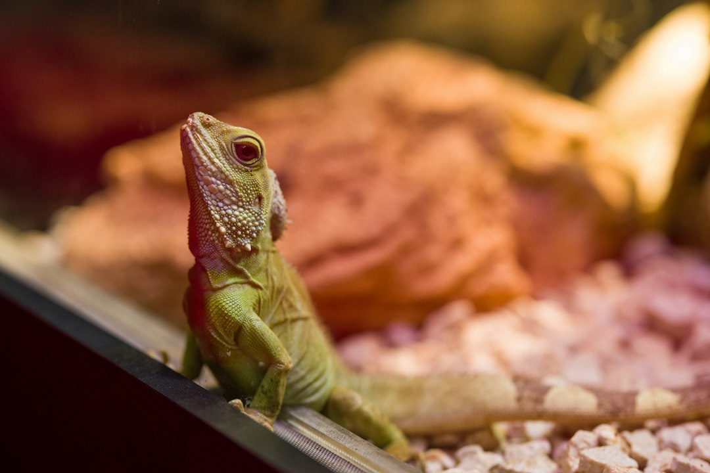

*This post contains affiliate links. As an Amazon Associate, I earn from qualifying purchases at no extra cost to you.*

A heat source plugged straight into the wall is a gamble. It has no idea what the enclosure temperature is, so it keeps heating when the room warms up in July and falls behind when the house cools in January. Keepers usually discover this the hard way, through a lizard that stops eating, a hide that is too hot to touch, or a thermometer reading that has quietly drifted ten degrees from where it started.

The fix is two separate tools doing two separate jobs. A thermostat controls the heat source. A monitor tells you whether the thermostat is actually succeeding. Treating them as one purchase is the most common budgeting error in reptile setups.

The position of this guide is simple: every powered heat source should run through a thermostat, and every enclosure should have at least one independent thermometer that is not part of the thermostat. Below you will find how the main thermostat types differ, where three specific products fit, how to place probes, and the mistakes that cause most failures.

Photo by <a href="https://unsplash.com/@enginakyurt?utm_source=artlines_blog&utm_medium=referral">engin akyurt</a> on <a href="https://unsplash.com/?utm_source=artlines_blog&utm_medium=referral">Unsplash</a>

## Why every reptile thermostat setup starts with a sensor you can trust

Reptiles are ectotherms, so the temperatures you provide are not a comfort feature. They drive digestion, immune function, shedding, and activity. Veterinary references on reptile husbandry, including the [Merck Veterinary Manual's reptile section](https://www.merckvetmanual.com/exotic-and-laboratory-animals/reptiles), consistently describe appropriate environmental temperature as a core requirement and a leading factor in husbandry-related illness.

An unregulated heater fails in two directions. Too hot, and you risk burns or heat stress. Too cool, and you risk poor digestion and appetite problems. A thermostat closes that gap by measuring temperature with a probe and cycling power to keep the reading near a set point.

For crested geckos the target is modest. Common care guidance puts their comfortable range in the low to high 70s Fahrenheit, with temperatures climbing past the low 80s treated as a problem to fix. That means many keepers in climate-controlled homes need little or no supplemental heat for most of the year. A thermostat still matters in two cases: a room that dips in winter, or a heat source you add to prevent that dip. Our [crested gecko humidity and temperature management guide](/2026/06/15/crested-gecko-humidity-and-temperature-management-guide/) covers the target ranges in more depth.

For warmer species such as leopard geckos and ball pythons, the case is even stronger, because they depend on a deliberate warm spot. In those setups the thermostat is the difference between a stable gradient and a daily guessing game.

One principle holds across species: the thermostat protects against equipment failure and seasonal swings, while your own readings confirm the result. Never assume the set point on a controller equals the temperature where your animal actually sits.

## On/off, pulse proportional, and dimming: how thermostat types differ

Not all reptile thermostats behave the same way, and the control method determines which heat sources are safe to pair with them.

**On/off controllers** switch the outlet fully on when the probe reading falls below the set point and fully off when it rises above it. They are simple, inexpensive, and flexible. The tradeoff is cycling. The temperature swings slightly around the target, and the heat source and relay take repeated hard starts. This works well for heat mats, ceramic heat emitters, and many other heaters, but it is a poor match for a basking bulb, since the light flicking on and off is stressful to look at and hard on the bulb.

**Pulse proportional controllers** send power in rapid pulses, with the duty cycle increasing as the temperature drops further below the set point. The result is a steadier temperature with smaller swings. They suit heat mats and ceramic emitters, where fast switching does not matter because the output is not visible light.

**Dimming controllers** vary the voltage to a bulb or similar load, so the light does not flicker. These are intended for incandescent or halogen basking bulbs. Dimming controllers should not be paired with ceramic heat emitters or non-dimmable loads, because the output type has to match the heat source.

A practical way to choose:

- If you run a heat mat or a ceramic heat emitter and want the simplest, most affordable control, an on/off unit is adequate.
- If you run a basking bulb and care about steady light and fine temperature control, a dimming or proportional unit is the better fit.
- If you run more than one type of heater on the same enclosure, use separate controllers rather than one device for everything.

Always check the wattage rating on the controller and compare it to the combined draw of what you plug in. Going over the rating is a fire risk, not a minor inefficiency.

> **Safety warning:** Thermostats handle mains electricity and heat sources that can cause burns or fires. Use only devices rated for the wattage you connect, keep controllers and outlets away from water and misting spray, never cover or enclose a heat source without ventilation, and replace any unit with damaged cords or scorch marks. If you smell burning plastic or see melting, unplug it and stop using it. Consult a licensed electrician for any wiring beyond a standard outlet.

## Top thermostat and heater options

### Inkbird ITC-308: the flexible controller

The [Inkbird ITC-308](https://www.amazon.com/dp/B01HXM5UAC?tag=scaledkeeper-20) is a general-purpose digital temperature controller sold for fermentation, greenhouses, and terrariums. The listing describes a 110V, 10A, 1100W unit with heating and cooling modes. That dual-mode design is its real strength for reptile keepers.

With heating mode, you set a target and the heat outlet turns on below it. With cooling mode, a second outlet can drive a fan, which is useful in a warm room or a tall enclosure where a heat spike is a bigger risk than a cold snap. For a crested gecko, where overheating is a common concern, the ability to run a fan on a ceiling-mounted, high-limit trigger is a meaningful safety layer.

Where it fits best:

- Heat mats and ceramic heat emitters, where on/off cycling is fine.
- Room-level or large enclosure control where a fan provides cooling.
- Keepers who want a visible, adjustable controller with a digital display at a modest price.

Where it falls short: it is an on/off device, not a proportional one, so it will cycle around the set point. It is not intended for dimming a basking bulb, and a cycled bulb is a poor experience for the animal. Also read the listing carefully, because the product is marketed for homebrew and greenhouse use rather than for reptiles specifically, so you take on the responsibility for matching it to a safe load. The manufacturer's manual covers differential settings, which control how far the reading can drift before the heater switches.

Verdict: this is the pick for most keepers who run a mat or ceramic emitter and want a versatile, low-cost controller. Pair it with a separate thermometer to cross-check the readout.

### Exo Terra proportional thermostat: smoother control for enclosure heat

The [Exo Terra Dimming and Pulse Proportional Thermostat](https://www.amazon.com/dp/B08R29S2WB?tag=scaledkeeper-20) is built specifically for reptile terrariums, and the name tells you its two modes: dimming and pulse proportional. The practical benefit of proportional control is that the temperature at the probe can stay closer to the set point than it would with a simple on/off unit.

This matters most for species with a tight basking requirement. A bearded dragon or ball python keeper whose basking spot has to hold a specific range will notice the steadier output. For crested geckos, a proportional unit is rarely essential, though it is a good choice if you are running a low-wattage heat source and want a gentle, consistent output rather than a bang-bang cycle.

Points to check before buying:

- **Load type.** Confirm the mode you intend to use is appropriate for the heat source. Dimming is for bulbs, pulse is for non-light heat sources. Using the wrong mode can cause flicker, humming, or unreliable control.
- **Wattage limit.** Read the rating on the listing and keep your total load below it.
- **Probe placement.** The unit relies on a single probe, so where it sits determines everything.

Expect a simpler interface with fewer programmable options, such as no cooling mode. That tradeoff is reasonable if your priority is stable heat control for a single heat source.

Verdict: choose the Exo Terra when you want smoother output, and choose the Inkbird when you want flexibility or a cooling mode. If you want both smooth heat and fan cooling, run a proportional unit on the heat and a separate controller on the fan.

### Zoo Med Reptitherm undertank heater: useful for some species, questionable for others

The [Zoo Med Reptitherm Undertank Heater 10-20 Gal 6x8](https://www.amazon.com/dp/B00BUFWCNC?tag=scaledkeeper-20) is an undertank heater listed for 10-20 gallon tanks. It is a thermostat accessory in the sense that it is the type of heater most commonly paired with one, and it is the clearest example of why control matters.

Undertank heaters warm the floor of the enclosure by conduction. That makes them a good match for ground-dwelling species that rely on belly heat, such as leopard geckos and many snakes. It also makes them a poor match for an arboreal gecko. Crested geckos live and rest above the ground, so floor heat does little for them, and it can dry out substrate in a humid, bioactive setup. If your enclosure uses a thick drainage layer and live plants, a heat mat can also interfere with moisture balance.

For the species where a mat is appropriate, three rules apply:

1. **Always put it on a thermostat.** An unregulated mat can climb to temperatures that damage glass or burn an animal that rests directly on the warm spot.
2. **Mount it on the outside of the enclosure bottom,** never inside, and never under a substrate the animal can burrow down to touch.
3. **Size it to cover only part of the floor,** which preserves a cooler zone so the animal can thermoregulate.

The Reptitherm listing is sized for tanks in roughly the 10 to 20 gallon range. If your enclosure is a different size or material, check compatibility, because glass thickness and wooden or PVC bases change how heat transfers. Our guide on [how to build a custom PVC reptile enclosure](/2026/06/10/how-to-build-a-custom-pvc-reptile-enclosure/) is relevant here, since PVC walls hold heat differently than glass.

Verdict: a reasonable, affordable heater for the right species, but only when run through a thermostat, and generally not the right primary heat source for crested geckos.

## Temperature monitoring: probes, placement, and independent checks

A thermostat reports one point. Your animal lives across a gradient. That gap is where most monitoring problems begin.

**Place the thermostat probe where the heat source does its work.** For a basking bulb, the probe belongs at basking height, near the spot the animal will actually use, but shielded so it does not read the bulb's radiant heat directly. For a mat, the probe typically sits on or just above the surface being heated, as the manufacturer instructs. A probe hanging in open air near a heater will read very differently from one touching the target surface.

**Add an independent thermometer.** A second device that does not belong to the thermostat catches a failed probe, a drifted set point, or an outlet that stopped switching. Digital probe thermometers with a min/max memory are especially useful, because they show you the overnight low and the afternoon high without you being present.

**Use an infrared temperature gun for surfaces.** A point-and-shoot infrared gun is the fastest way to map the warm spot, the cool end, and the substrate. Treat its readings as surface temperatures, not air temperatures, and verify it against a reference occasionally.

**Consider remote alerts.** A Wi-Fi sensor or smart plug alarm that texts you when a reading leaves a set range gives you early warning while you are at work or traveling. We cover options in our guide to [how to monitor a reptile enclosure remotely](/2026/08/05/how-to-monitor-reptile-enclosure-remotely/).

**Check accuracy once.** Inexpensive thermometers can differ by several degrees. Compare two or three devices in the same spot for a few minutes. If one is an outlier, replace it. The consensus in veterinary guidance, including from groups such as the [Association of Reptile and Amphibian Veterinarians](https://arav.org/), is that correct husbandry depends on measuring conditions rather than estimating them.

## How to choose and install a reptile thermostat

Use this quick comparison to match a controller to your setup.

| Product | Control type | Best heat source | Cooling | Best for |
|---|---|---|---|---|
| Inkbird ITC-308 | Digital controller with heating and cooling modes | Various heat sources | Yes, cooling mode | Flexible control |
| Exo Terra Dimming and Pulse Proportional | Proportional (dimming and pulse) | Check the product's compatibility with your heat source | No | Smooth, steady heat |
| Zoo Med Reptitherm 6x8 | Heater only, needs a thermostat | Floor heat for tanks | No | Ground-dwelling species |

A simple decision framework: if your animal needs a precise basking spot, consider a proportional unit, and confirm it suits your heat source. If your animal needs ambient warmth and your room is the main variable, start with the Inkbird and consider a fan on its cooling mode. If your animal is arboreal and your room stays in the low to mid 70s, you may only need a monitor and an alarm, not a heater at all.

To install any controller safely:

1. **Set up the enclosure and heat source first,** and confirm the combined wattage is under the controller's rating.
2. **Plug the controller into the wall,** then plug the heat source into the controller outlet, never the reverse.
3. **Place the probe** at the working location and secure the cable so the animal cannot chew or drag it.
4. **Set the target temperature** a few degrees below your maximum safe limit, then let the system run for an hour.
5. **Verify with an independent thermometer** and adjust the set point or probe position until the reading at the animal's level matches your target.
6. **Test the failure case** by temporarily raising the set point and confirming the outlet shuts off when expected.

Run this check again after seasonal changes, since a controller tuned for winter can overheat in summer.

## Common reptile thermostat mistakes and problems to avoid

Most failures trace back to a short list of errors. Avoiding them does more for your animal than upgrading the hardware.

**Skipping the thermostat on a "low-wattage" heater.** Small heaters feel harmless, but a stuck-on mat or lamp has no way to stop itself. Every powered heat source belongs on a controller.

**Mismatching the controller and the load.** A dimming unit driving a ceramic emitter, or an on/off unit cycling a basking bulb, produces flicker, noise, or unreliable temperatures. Match the mode to the heat source, and stay under the wattage rating.

**Trusting the controller's display as the final word.** A probe placed in the wrong spot will report a perfect number while the animal sits in a different climate. Always cross-check with an independent thermometer.

**Putting the probe where the heater can see it.** A probe that reads direct radiant heat from a bulb will shut the system off early, leaving the cool end too cold. Shade it or position it per the manufacturer's guidance.

**Ignoring the cool side.** A gradient needs a cool end. Heating an entire small enclosure uniformly removes the animal's ability to regulate, which is especially risky in a tiny tank.

**Forgetting humidity and moisture around electronics.** Misting systems and splashes can reach outlets and controllers in humid setups. Keep electrical connections elevated and shielded, and use a drip loop on cords. Our guide to [automatic misting systems](/2026/09/25/best-automatic-misting-systems-for-crested-gecko-humidity-control/) discusses layout choices that keep spray away from equipment.

**Never testing the failure mode.** If you have not confirmed the controller actually cuts power at the set point, you do not know it works. Test it once, and retest after any change.

**Heating a species that does not need it.** If your room already holds a safe temperature, adding heat creates risk without benefit. Measure first, then decide.

## FAQ

### Do crested geckos need a thermostat?

Not always. Crested geckos do well at typical room temperatures in the low to mid 70s Fahrenheit, and common care guidance warns against sustained heat above the low 80s. If your home stays in range, a quality thermometer with min/max memory may be all you need. A thermostat becomes worthwhile when winter drops the room below your target range, or if you add any supplemental heat source. In that case, a controller with a high-limit cutoff or a cooling outlet adds an important safety layer. The decision should rest on measured readings in your enclosure rather than on a rule of thumb, so log temperatures for a week before buying heating equipment.

### Is a proportional thermostat worth the extra cost over an on/off model?

It depends on the heat source. For a basking bulb, a dimming or proportional unit is usually worth it, because it avoids bulb flicker and holds the temperature more steadily. For a heat mat or ceramic emitter in an enclosure with a forgiving range, an on/off controller is often sufficient, and the savings are meaningful. The main benefit of proportional control is smaller temperature swings, which matters most for species with a narrow basking requirement. If your animal tolerates a few degrees of variation and your room is stable, the extra cost may not change outcomes. If you need tight control, pay for it.

### Where should I put the thermostat probe?

Place the probe at the location whose temperature you want to control, usually the warm spot at the animal's level, and shield it from direct radiant heat from a bulb. For a heat mat, follow the manufacturer's guidance, which typically means placing the probe on or near the heated surface. Secure the cable so the animal cannot pull or chew it. After setting it, confirm the reading with an independent thermometer or infrared gun at the same spot. If the two disagree by several degrees, adjust the probe position first, then the set point. The probe location matters more than the brand of controller.

### How often should I check my temperature equipment?

Glance at readings daily as part of your routine, and review the min/max memory weekly to catch overnight lows and afternoon highs. Test the thermostat's shutoff behavior when you first install it, after any equipment change, and at each change of season. Replace probes or thermometers that show drift or inconsistent readings, and inspect cords and outlets for heat damage. Remote alerts help close gaps when you are away. A short monthly checklist, covering probe position, cord condition, and a cross-check against a second thermometer, catches most problems before they affect your animal.

## Conclusion

Precise enclosure control comes from pairing the right controller with the right heat source and then verifying the result with a second thermometer. For most keepers, the [Inkbird ITC-308](https://www.amazon.com/dp/B01HXM5UAC?tag=scaledkeeper-20) is the versatile starting point, the [Exo Terra proportional thermostat](https://www.amazon.com/dp/B08R29S2WB?tag=scaledkeeper-20) is the better choice when you want smoother heat control, and a heater like the [Zoo Med Reptitherm](https://www.amazon.com/dp/B00BUFWCNC?tag=scaledkeeper-20) belongs only on a thermostat and only with species that benefit from floor heat.

Your next step is simple: put a thermometer with min/max memory in your enclosure tonight, log a week of readings, and decide from the data whether you need heat control or just an alarm.

If this guide helped, bookmark it for your next equipment check and leave a comment with your setup.

- [How To Monitor Reptile Enclosure Remotely](/2026/08/05/how-to-monitor-reptile-enclosure-remotely/)
- [How To Set Up A Dedicated Reptile Room](/2026/07/29/how-to-set-up-a-dedicated-reptile-room/)

  
<strong>About the Author</strong>

  
The Scaled Keeper team researches reptile husbandry with a focus on gecko and lizard care. Our guides synthesize keeper community data, veterinary sources, and documented husbandry outcomes - so you can make informed decisions for your animals.

