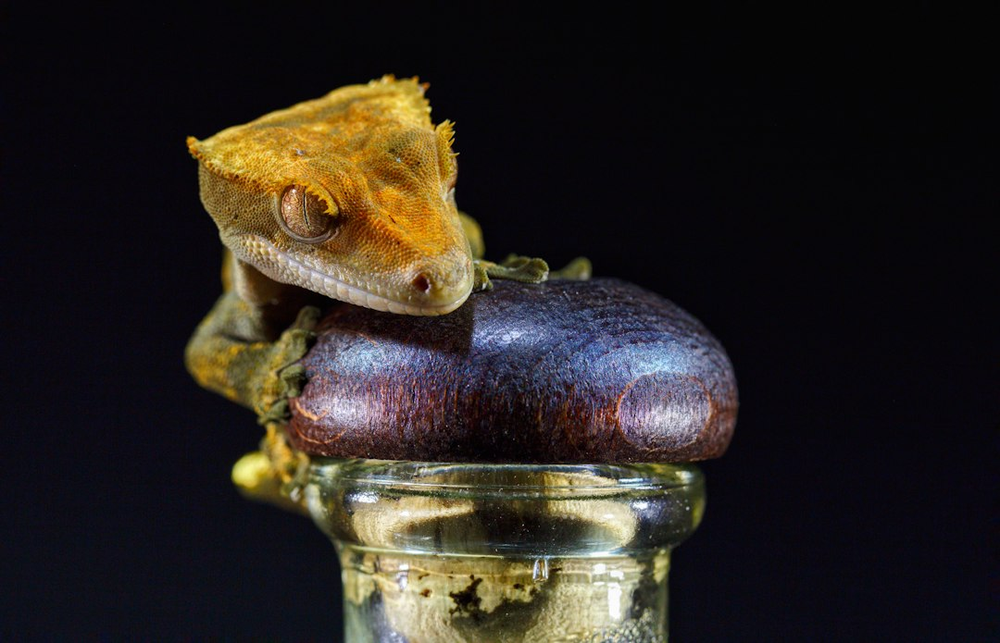

*This post contains affiliate links. As an Amazon Associate, I earn from qualifying purchases at no extra cost to you.*

A female crested gecko does not need a male to produce eggs. Once she is mature and well fed, her body can build follicles and shell them on a cycle, whether or not anyone planned a breeding project. That is why egg binding catches so many keepers off guard. People with a "single pet gecko" find out she is gravid only when she stops eating, hides on the enclosure floor, and looks bloated.

My position is simple: egg binding (dystocia) in crested geckos is mostly a prevention problem, and the prevention work is boring. Adequate body weight, steady calcium, a proper lay site, stable temperatures, and honest observation do more than any rescue technique. When prevention fails, the correct emergency response is also unglamorous: stay calm, keep her warm and quiet, and get her to a reptile veterinarian the same day. This guide covers both halves, and it is blunt about what you should never attempt at home.

Photo by <a href="https://unsplash.com/@anritikhon?utm_source=artlines_blog&utm_medium=referral">Andrey Tikhonovskiy</a> on <a href="https://unsplash.com/?utm_source=artlines_blog&utm_medium=referral">Unsplash</a>

## What Egg Binding in Crested Geckos Actually Is (and Is Not)

Egg binding, or dystocia, means a female cannot pass one or more eggs at the time she should. Crested geckos typically lay two eggs per clutch, and a healthy female producing infertile or fertile eggs may lay a new clutch roughly every month or so during the breeding season. Because each cycle drains calcium and body mass, a female who is cycling constantly is under real physiological pressure.

It helps to separate three situations that look similar to a worried keeper:

- **Normal gravid behavior.** Two pale, visible eggs against the belly, some restlessness, extra digging, and a reduced appetite for a few days before laying. She is still alert, still climbs, and lays within a few days of digging.
- **Obstructive dystocia.** Something physically prevents passage: an oversized or misshapen egg, a narrow pelvis, or a malformed shell. She strains without producing anything.
- **Non-obstructive dystocia.** Nothing blocks the eggs, but weak muscle contractions, usually tied to low calcium, poor condition, or stress, fail to push them out. In captive reptiles this is generally considered the more common pattern, and it is the one keepers can most influence.

The Merck Veterinary Manual's [reptile reference section](https://www.merckvetmanual.com/exotic-and-laboratory-animals/reptiles) describes reproductive disorders in reptiles as often tied to husbandry, including nutrition and nesting conditions. That matches how experienced breeders talk about crested geckos: a female that is too small, too thin, or short on calcium is the one that gets into trouble.

The key point is that egg binding is a true emergency. A bound female can deteriorate quickly, and the problem does not resolve with patience the way a mild shed issue sometimes does.

## Prevention Starts With Body Weight, Age, and Cycle Control

The single most useful prevention step is refusing to let an immature or underweight female cycle. Many breeders and vets recommend waiting until a female is at least 18 months old and comfortably above 35 to 40 grams before pairing, and plenty of careful keepers prefer 40 grams or more. Weight matters more than age, because a slow-growing 20-month-old can still be too small.

You cannot manage what you do not measure, so weigh her. A gram scale that reads to 0.1 or 1 gram is non-negotiable if you keep a female you suspect could be gravid. Our guide to [the best gram scales for weighing geckos and small reptiles](/2026/08/16/best-gram-scales-for-weighing-geckos-and-small-reptiles/) covers the practical options. Weigh weekly during any breeding season and write the numbers down. Weight that climbs steadily with no visible eggs is not automatically a problem, but weight that falls while she looks swollen is a red flag.

Pair weight data with a visual check. Our [crested gecko body condition score guide](/2026/08/17/crested-gecko-body-condition-score-underweight-healthy-and-overweight-examples/) shows what a healthy tail base and hip area look like. A female with a thin tail and prominent hips has no reserves to produce eggs.

### Control the cycle if you are not breeding

If you do not want eggs, the practical choices are limited:

- **Housing alone.** A female kept without a male can still produce infertile clutches. Keeping her single does not prevent follicle development.
- **Reducing triggers.** Some keepers report fewer cycles when females are kept at stable, moderate temperatures and are not overfed. This is anecdotal rather than guaranteed.
- **Veterinary options.** Reproductive suppression exists for some reptiles, and surgical spaying (ovariectomy) is available at some exotic practices. Ask a reptile vet whether it is appropriate for your animal.

Do not respond to a worry about eggs by starving her. Underfeeding a gravid or cycling female makes dystocia more likely, not less.

For breeders, the broader process is covered in our [crested gecko breeding guide](/2026/09/30/crested-gecko-breeding-guide-courtship-eggs-and-hatchling-care/), which includes pairing weights and rest periods between seasons. Build rest periods into your plan. A female laid out for months with no recovery is the classic setup for a calcium crash.

## Calcium and Vitamin Strategy for Laying Females

Egg shells are mostly calcium, and a female making repeated clutches pulls that calcium from her blood and bones. If dietary intake cannot keep up, she borrows from her skeleton. That is how you end up with a gecko that has weak contractions, tremors, or metabolic bone disease on top of a reproductive problem.

The foundation for a crested gecko is a complete powdered crested gecko diet formulated with balanced calcium and phosphorus. Our article on [understanding reptile nutrition labels and CGD ingredients](/2026/06/22/understanding-reptile-nutrition-labels-and-cgd-ingredients/) explains how to check calcium to phosphorus ratios. Many keepers add a separate calcium source for females that are cycling, and this is where supplement choice matters.

Here is a practical way to think about the three-part toolkit:

- **A calcium supplement with D3 for laying females.** The [Zoo Med Reptile Calcium with Vitamin D3, 8-Ounce](https://www.amazon.com/dp/B000UJSUO4?tag=scaledkeeper-20) is one option that includes D3. Read the current label for its D3 content and follow the manufacturer's dosing, because stacking multiple D3 sources is a known way to overdo it.
- **A multivitamin without D3 as a rotation option.** The [Zoo Med Reptivite without D3](https://www.amazon.com/dp/B00167S5GC?tag=scaledkeeper-20) fills the vitamin side without adding more D3 on top of a diet or supplement that already supplies it.
- **Your actual diet as the base.** A well-formulated CGD, plus occasional insects, does most of the work. Supplements adjust the margins.

The main tradeoff is dosing discipline. More is not better. Excess vitamin D3 can cause its own toxicity problems, and too little calcium causes the weak-contraction problem you are trying to prevent. Pick a schedule, document it, and review it with your vet if she is cycling heavily. For a deeper comparison of products and schedules, see our guide to [calcium and vitamin supplements for crested gecko nutrition](/2026/09/14/best-calcium-and-vitamin-supplements-for-crested-gecko-nutrition/).

Also note that live insects are an optional extra, not a requirement. If you offer them, dust them as appropriate and pair the practice with the feeding approach in our [live insect feeding guide](/2026/09/18/which-live-insects-to-feed-crested-geckos-and-how-to-culture-them/).

## Build a Lay Box That Females Actually Use

A female that cannot find a suitable place to lay may hold her eggs. That alone can contribute to dystocia, which makes the lay site one of the cheapest and most effective preventive tools.

A good lay box for a crested gecko is not complicated. Use a deli-style or small plastic container with a secure lid and a hole cut in the side or top for access. Fill it with 3 to 5 inches of slightly moist, loose substrate such as sphagnum moss mixed with coco fiber, or a plain peat and perlite blend. Squeeze a handful: it should hold together without dripping. Too wet and the eggs can rot; too dry and the substrate collapses when she digs.

Position the box where she already spends time, ideally off the floor on a ledge or low branch, or on the enclosure floor if she prefers ground-level digging. Cover it so it feels secure. Many females need several days of digging before they commit, so do not remove the box after one visit.

Stress, heat, and dehydration all worsen reproductive problems. Crested geckos do best with a daytime range in the low to mid 70s Fahrenheit, a nighttime drop, and a humidity pattern that cycles between higher at night and drier by day. Sustained temperatures above roughly 80 degrees Fahrenheit are a risk for any crested gecko, and a gravid female has less tolerance.

Put a reliable sensor in the enclosure rather than guessing. A Bluetooth unit such as the [Govee Indoor Hygrometer Thermometer H5075](https://www.amazon.com/dp/B07Y36FWTT?tag=scaledkeeper-20) logs temperature and humidity so you can see overnight lows and daytime peaks from your phone. Logs are helpful for diagnosing a stressed female, and your vet will likely ask for numbers. Our guide to [crested gecko humidity and temperature management](/2026/06/15/crested-gecko-humidity-and-temperature-management-guide/) explains target ranges in detail.

If you use automated misting, confirm it is not soaking the lay box. See our overview of [automatic misting systems for crested gecko humidity control](/2026/09/25/best-automatic-misting-systems-for-crested-gecko-humidity-control/) for placement ideas.

## Emergency Response to Egg Binding in Crested Geckos

**Safety note:** Do not attempt to massage, squeeze, puncture, or pull an egg out of your gecko at home. A crested gecko's shell is thin and the eggs are delicate; a cracked egg inside her can cause infection, internal injury, or death. Medications used for dystocia, such as calcium injections and oxytocin, require a veterinarian's dosing and judgment. Never give hormones or injectables yourself.

First, decide whether this is an emergency. Use this comparison:

| Observation | Likely normal gravid | Treat as emergency |
|---|---|---|
| Appetite | Reduced for a few days | Refuses food for many days |
| Energy | Alert, restless, digging | Lethargic, limp, glassy-eyed |
| Digging | Digs, then lays within days | Digs repeatedly without result |
| Straining | None or brief | Repeated straining, pushing, or tremors |
| Eggs | Visible, stable | Visible for more than a few days with no progress |
| Body | Plump but moves normally | Swollen, pale, or weak limbs |
| Mouth and breathing | Normal | Open-mouth breathing or gaping |

If two or more emergency signs match, or you are unsure, treat it as an emergency. Waiting to see if she "figures it out" costs time she may not have.

Follow these steps:

1. **Confirm and note the timeline.** Write down when you last saw her eat, when she started digging, how long the eggs have been visible, and her last recorded weight. Your vet will use this.
2. **Call a reptile-experienced vet immediately.** Describe the symptoms and say you suspect dystocia. Many general clinics do not treat reptiles, so confirm before driving. The Association of Reptile and Amphibian Veterinarians maintains a [directory to find a qualified veterinarian](https://arav.org/), and our guide to [finding a herp vet on a budget](/2026/07/27/reptile-veterinary-care-finding-a-herp-vet-on-a-budget/) covers cost control.
3. **Keep her warm and calm, not hot.** Place her in a small, ventilated, secure container with a damp paper towel, in a quiet room with a room temperature in the low to mid 70s Fahrenheit. Do not apply heat lamps or heating pads that could overheat her.
4. **Offer a lay box and leave her alone.** If she is still strong, a moist lay box for a short, supervised period may let her pass eggs on her own. Do not wait more than a short window before the vet appointment.
5. **Transport safely.** Use a ventilated container, pack soft paper towels to prevent jostling, and keep the car comfortable. Bring a photo of her enclosure, supplement labels, and your weight log.
6. **Follow vet instructions exactly.** Typical veterinary approaches include an exam, radiographs or ultrasound to count and assess eggs, supportive fluids, calcium, and sometimes oxytocin. In some cases, vets perform egg aspiration or surgery. Complete any medications and recheck visits.

After treatment, give her recovery time. Many vets recommend preventing further cycling until she is fully recovered, which is a conversation to have at the appointment. Our guide on [common health issues in crested geckos](/2026/10/12/common-health-issues-in-crested-geckos-signs-treatment-and-prevention/) can help you track other warning signs during recovery.

## Common Mistakes That Make Egg Binding Worse

Most dystocia cases that go badly involve one or more avoidable errors. These are the ones that come up most often in keeper and breeder discussions.

**Breeding too young or too light.** A female that is under 35 grams or less than a year and a half old may not have the body mass or skeletal development to lay safely. Waiting is cheap. Losing a female is not.

**Skipping calcium or supplementing erratically.** Leaving the supplement jar on the shelf for weeks and then dosing heavily is the worst of both worlds. Consistent, label-based dosing is safer than bursts.

**Doubling up on D3.** Using a D3 calcium, a D3 multivitamin, and a fortified diet in the same week can overshoot. If you use a D3 calcium like Zoo Med Reptile Calcium with Vitamin D3, a D3-free multivitamin like Reptivite without D3 is the logical pairing, but still check labels.

**Offering no lay site, or the wrong one.** A bare tank with dry substrate gives her no option. A lay box that is soggy, too shallow, or exposed also gets ignored.

**Running the enclosure too warm.** Heat stress compounds everything. If your room runs hot in summer, solve that first. A thermostat setup, covered in our [reptile thermostat guide](/2026/05/29/reptile-thermostat-guide-on-off-vs-dimming-vs-pulse-proporti/), is more relevant to other species but the monitoring logic applies.

**Waiting too long.** The most common serious mistake is giving it "one more day" repeatedly. If she is straining, lethargic, and has visible eggs for days, call the vet.

**Trying home remedies.** Warm soaks, belly massage, and forcing food or water are frequently suggested online. They can injure or aspirate a weak gecko. Hold her gently, if at all, and leave treatment to the clinic.

**Ignoring the aftermath.** A female who passes eggs after a rough episode may still be depleted. Re-weigh her, increase observation, and avoid pairing her again until a vet clears her.

## Frequently Asked Questions

### Can a female crested gecko lay eggs without a male?

Yes. A mature female can produce infertile eggs without ever meeting a male, much like a hen producing eggs. These eggs are usually called slugs when they are infertile and deflated or discolored. The process is just as physically demanding as laying fertile eggs, and it carries the same dystocia risk. If your female is old enough and well fed, you should provide a lay box even if you have never bred her. Keep supplements on a consistent schedule, weigh her regularly, and call a reptile vet if she shows straining, lethargy, or prolonged digging without laying.

### How long can a crested gecko stay gravid before it is a problem?

There is no single number that applies to every gecko, because individual females vary and eggs can be visible for several days before laying. As a practical guideline, a female that digs repeatedly for several days without laying, or that shows lethargy, straining, tremors, or a swollen belly, needs a veterinarian. Do not wait for an arbitrary week-long window. If she stops eating, becomes weak, or you are uncertain, call a reptile vet that day. Describe the timeline and symptoms so the clinic can triage appropriately and tell you whether to come in immediately.

### Can I help my crested gecko lay eggs at home?

You can improve the setting, but you should not physically intervene. Provide a covered lay box with moist, loose substrate, keep temperatures in the low to mid 70s Fahrenheit, reduce disturbance, and keep supplements consistent. Do not massage her abdomen, give hormones, or try to remove an egg, because the shell can break internally and cause serious injury. If she has not laid after a short period in a suitable lay site, or shows any emergency sign, she needs a reptile vet. Veterinary treatment often includes calcium support, fluids, imaging, and sometimes oxytocin or surgery.

### Should I spay a female crested gecko that keeps laying?

It is worth discussing with a reptile veterinarian, particularly if a female cycles constantly, has lost weight, or has had a dystocia episode. Surgical spaying is a significant procedure that carries anesthesia risk, and not every exotic vet performs it on geckos. Alternatives include careful weight and calcium management, adjusting husbandry, and reducing triggers where possible. The right choice depends on her size, condition, and history. Ask about costs, risks, and aftercare in advance, and compare that to the expense and risk of repeated emergencies.

Egg binding in crested geckos is frightening, but most of the risk is manageable before it starts. Keep females at a healthy weight before they cycle, supplement calcium consistently without stacking D3 carelessly, provide a proper lay box, and keep temperatures stable. Weigh her, log the numbers, and trust what the scale and her behavior tell you.

If she shows straining, lethargy, or prolonged digging with visible eggs, stop researching and call a reptile veterinarian. Keep her warm, calm, and contained, and leave the medical decisions to the clinic. Your next step today: check your female's last weight, confirm you have a lay box set up, and save the number of your nearest reptile vet before you need it.

If this guide helped, bookmark it for the next breeding season and leave a comment with questions about your own setup.

## Related Reading

- [Crested Gecko Breeding Guide: Courtship, Eggs, and Hatchling Care](/2026/09/30/crested-gecko-breeding-guide-courtship-eggs-and-hatchling-care/)
- [Crested Gecko Losing Weight: Causes, Tracking, and When to Call a Vet](/2026/08/19/crested-gecko-losing-weight-causes-tracking-and-when-to-call-a-vet/)

  
<strong>About the Author</strong>

  
The Scaled Keeper team researches reptile husbandry with a focus on gecko and lizard care. Our guides synthesize keeper community data, veterinary sources, and documented husbandry outcomes - so you can make informed decisions for your animals.

