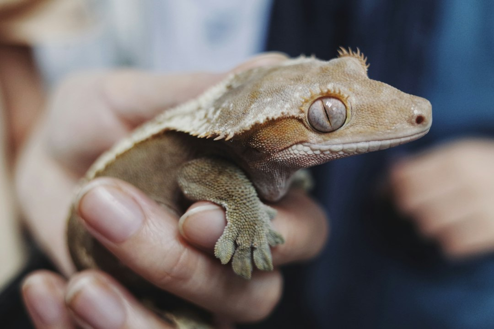

*This post contains affiliate links. As an Amazon Associate, I earn from qualifying purchases at no extra cost to you.*

Most crested gecko "taming" advice gets the goal backwards. You are not training a dog to like you. You are lowering the threat level for a small, arboreal, prey-sized animal until it stops treating your hand as a predator. That takes weeks, and it goes faster when you do less, not more.

The approach that works best for most keepers is slow, short, evening-only sessions that the gecko can leave at any time, built on a stable enclosure and predictable routines. Grabbing, chasing, and long sessions feel productive but set you back. A gecko that leaps off your hand, drops its tail, or freezes in a corner is telling you the pace is wrong.

This guide covers the enclosure conditions that make calm behavior possible, stress signals, a step-by-step plan, hand-feeding, safety rules, and the mistakes that most often stall progress. Expect several weeks to a few months, and expect individuals to differ. Some are bold from day one. Others stay skittish for life and still do fine as display animals.

Photo by <a href="https://unsplash.com/@blsnki?utm_source=artlines_blog&utm_medium=referral">Yeh Xintong</a> on <a href="https://unsplash.com/?utm_source=artlines_blog&utm_medium=referral">Unsplash</a>

## Why Crested Geckos Need a Different Approach to Handling

Crested geckos (*Correlophus ciliatus*) are nocturnal and crepuscular climbers from New Caledonia. In the wild they hunt small insects and are prey for birds and other animals. Their defense is to freeze, hide, or leap, and a gecko that cannot tell your hand from a predator will default to leaping. That is why handling feels so different from working with a bearded dragon or leopard gecko, which tend to tolerate being scooped up.

Three biological facts shape everything below:

- **They jump and fall.** Crested geckos are strong, unpredictable leapers. A fall from shoulder height onto a hard floor can injure a gecko, so every session happens low and close to a soft surface.
- **They can drop their tails.** Tail autotomy is a stress response, and crested geckos do not regrow the tail. A dropped tail is not usually a medical emergency, but it is permanent. Our guide on [crested gecko tail loss and regeneration](/2026/10/30/crested-gecko-tail-loss-and-regeneration-timeline-and-care/) explains what to expect and how to care for the wound.
- **Their skin is delicate.** Squeezing, pinching the tail base, or pulling a gecko off a surface it is gripping with its toe pads can cause injury.

In practice, "taming" means habituation. You are teaching the gecko that your hand is boring and safe: it arrives, nothing bad happens, and it leaves. Trust in a reptile is mostly the absence of fear responses, not affection.

If you are new to reptiles in general, the principles in our post on [how to safely handle and tame a new reptile](/2026/06/19/how-to-safely-handle-and-tame-a-new-reptile/) apply here too, with the crested gecko adjustments below.

## Build a Calm Enclosure Before You Handle and Tame a Crested Gecko

A gecko that is thermally stressed, dehydrated, or exposed cannot relax around you. Chronic stress from a bad setup outweighs any amount of patient hand work.

### Temperature and humidity

Care sheets from reputable breeders and veterinary sources commonly recommend daytime temperatures in the low to mid 70s Fahrenheit, avoiding sustained heat above the high 70s, with a nightly humidity spike to roughly 60 to 80 percent and a drying-out period during the day. Overheating is a bigger welfare risk than a cool room for this species. Our [crested gecko humidity and temperature management guide](/2026/06/15/crested-gecko-humidity-and-temperature-management-guide/) walks through the targets and how to hit them.

Consistency matters as much as the numbers. If you rely on manual misting, a missed evening can leave a gecko dry and irritable. An automatic system such as the [Exo Terra Monsoon Solo II programmable misting system](https://www.amazon.com/dp/B08KJ4G2XL?tag=scaledkeeper-20) removes the daily variable, and it is listed with multiple nozzles for humidity control. It is one of several options, so compare it in our roundup of [automatic misting systems for crested gecko humidity control](/2026/09/25/best-automatic-misting-systems-for-crested-gecko-humidity-control/) before buying.

### Substrate and cover

Loose, moisture-holding substrate supports humidity and gives the gecko a natural floor. A product like [Zilla Jungle Mix terrarium substrate](https://www.amazon.com/dp/B007UE10HG?tag=scaledkeeper-20) is an organic blend marketed for tropical terrariums. One caution: many keepers start hatchlings and juveniles on paper towels for the first weeks, which makes it easy to monitor feeding and droppings and avoids any chance of ingesting loose material. Move to loose substrate once the gecko is established and eating well. Our post on the [best substrates for crested geckos](/2026/06/19/best-substrates-crested-gecko/) compares the options.

### Hides and foliage

Dense foliage at multiple heights is not decoration. A gecko with plenty of cover feels safe enough to come out. Put hides and vines in the upper and middle zones, since a gecko hiding only at ground level is often a stressed one.

### Leave a new gecko alone first

After a gecko arrives, a common recommendation is to wait at least one to two weeks before any handling. Use that time to confirm it is eating, drinking, and passing normal droppings. If you are adding a gecko to a household with other reptiles, follow the [quarantine protocols for introducing new geckos safely](/2026/10/28/quarantine-protocols-introducing-new-geckos-safely-and-disease-prevention/) before any shared handling or equipment.

## Reading Stress Signals Before You Reach In

Crested geckos communicate clearly if you know what to look for, and the best handling habit is stopping at the first warning sign rather than the last.

| Signal | What you see | What it usually means | What to do |
|---|---|---|---|
| Calm | Slow movement, relaxed toes, eyes fully open, may lick its eyes or nose | Comfortable with the situation | Continue, keep the session short |
| Alert curiosity | Head raised, tracking your hand, tongue flicks | Assessing, not alarmed | Hold still and let it approach |
| Freezing | Sudden stillness, body pressed flat | Fear, trying not to be noticed | Slow down, do not grab, wait it out |
| Fire up/down | Rapid color change during the session | Can reflect stress, arousal, or time of day | Judge with body language, not color alone |
| Vocalizing | Chirps, squeaks, or barks | Defensive warning | End the session calmly |
| Leaping | Sudden jumps off your hand | Escape response | Keep hands low, return it gently if needed |
| Tail wagging or tension | Stiff body, twitching tail | High arousal | Stop and give it space |

Color change deserves a note. Crested geckos "fire up" at night when they become active, so darker, more saturated coloration alone is not proof of fear. A gecko that fires up while relaxed and exploring is normal, while one that fires up, flattens, and refuses to move is stressed.

### Know your individual gecko

Personality varies a lot, and some of that variation is age. Juveniles are often faster and more jumpy than calm adults. Our article on [crested gecko behavior and personality differences by age and individual](/2026/10/21/crested-gecko-behavior-and-personality-differences-by-age-and-individual/) helps you set realistic expectations so you do not read normal skittishness as failure.

### Health can look like attitude

A gecko that suddenly becomes defensive, stops eating, or hides constantly may be sick rather than "grumpy." Weight loss in particular should prompt a vet conversation, and tracking weight with a precise scale makes that easy. See our guide to the [best gram scales for weighing geckos](/2026/08/16/best-gram-scales-for-weighing-geckos-and-small-reptiles/) and the post on [crested gecko weight loss causes and when to call a vet](/2026/08/19/crested-gecko-losing-weight-causes-tracking-and-when-to-call-a-vet/).

## A Step-by-Step Plan to Handle and Tame a Crested Gecko

This progression is built around one rule: the gecko sets the pace. Move to the next step only after the gecko is relaxed at the current one for several consecutive sessions. A typical gecko needs a few days to a week or more at each stage, so do not treat the schedule as a deadline.

1. **Settle in (days 1 to 14).** Do only maintenance: misting, feeding, and spot cleaning. Move slowly, speak quietly if you like, and avoid reaching in from above. The gecko should learn that your presence is routine.

2. **Hand in the enclosure (weeks 2 to 3).** Once the gecko is eating reliably, rest a clean, still hand inside the enclosure for a few minutes in the evening, away from the gecko. Do not touch it. Let it see and smell you, and withdraw slowly. Repeat daily or every other day.

3. **Approach from the side, below eye level.** Predators strike from above, so offer your hand from the side or low in front. Let the gecko investigate and climb on voluntarily. If it retreats, back off and try again tomorrow.

4. **First short lifts (weeks 3 to 5).** When the gecko steps onto your palm, keep your hand low and stable inside the enclosure. After a minute or two, return it to its perch. Short, uneventful sessions teach more than long ones.

5. **Move to a controlled space.** Once the gecko stays calm on your hand inside the enclosure, try sessions of 5 to 10 minutes while sitting on the floor or low on a bed or sofa. A small, safe room with the door closed, no fans running, and any other pets out is ideal.

6. **Use the walking-hand method.** Let the gecko climb from one hand to the other, like a slow conveyor belt. This gives the gecko a path rather than a trap and reduces the urge to bolt.

7. **Build duration gradually.** Extend sessions slowly to 15 to 20 minutes for a confident gecko. Many keepers handle two to three times per week, never right after a meal and never during shedding.

### Timing and frequency

Handle in the evening when the gecko is naturally waking up. Waking it mid-sleep produces a defensive animal. Avoid handling for a day or two after feeding if your gecko is prone to regurgitation, and skip handling entirely during shed. For shedding concerns, our guide to [crested gecko molting problems](/2026/09/28/crested-gecko-molting-problems-troubleshooting-and-solutions/) covers what a healthy cycle looks like.

### When to retreat

If your gecko leaps repeatedly, vocalizes, or tenses up, end the session and return it to the enclosure calmly. Restart at an easier step the next day. Stepping back protects the trust you have built.

## Building Trust and Safe Handling Practices

Food is the fastest way to teach a crested gecko that your hand predicts good things. Hand-feeding works best once the gecko is already comfortable with your hand resting inside the enclosure.

### Offering food by hand

For a gecko eating a prepared crested gecko diet, offer a small dab on a spoon or the tip of a feeding utensil. For insects, a useful treat for geckos that accept them, soft-tipped tweezers keep your fingers clear and let you control the pace. The [Exo Terra stainless steel tweezers](https://www.amazon.com/dp/B001B5ATYA?tag=scaledkeeper-20) are listed with soft-coated tips and an ergonomic design, which suits delicate work around a small animal's mouth. Whichever tool you pick, avoid hard metal tips that could scrape the gecko's jaw if it lunges.

Use feeding sessions to bridge steps in the plan. A gecko that licks food from a tool held near your hand will often step onto your hand next. Keep treats occasional so you do not undermine its balanced diet. Portions are covered in our [crested gecko feeding schedule guide](/2026/10/02/crested-gecko-feeding-schedule-portions-and-feeding-frequency-by-age/), and our post on [which live insects to feed crested geckos](/2026/09/18/which-live-insects-to-feed-crested-geckos-and-how-to-culture-them/) covers safe feeder choices.

### Do not make food the only motivator

Some geckos come to associate your hand only with a meal and lunge at it. If that happens, rest your hand inside the enclosure without food on some days so the association stays neutral.

### Enrichment helps behavior

A gecko with branches to climb, places to hide, and room to explore is less likely to treat handling as its only stimulation. Our guide to [enclosure enrichment and decorations for crested geckos](/2026/10/16/enclosure-enrichment-and-decorations-for-crested-gecko-behavior-and-mental-healt/) has setup ideas that complement a handling routine.

### What you do not need

You do not need gloves, special perches, or "calming" products. Clean, unscented hands are enough. Avoid lotions, perfumes, and strong soaps right before handling, since residue can irritate a gecko's skin and mask your natural scent.

**Safety note:** Reptiles, including crested geckos, can carry *Salmonella* even when they look healthy. The CDC advises washing your hands with soap and water after handling reptiles or anything in their enclosure, keeping them out of kitchens and food-prep areas, and being especially careful around children under five, older adults, and people with weakened immune systems. See the [CDC's healthy pets guidance](https://www.cdc.gov/healthy-pets/) for current recommendations. If a household member develops stomach illness after reptile contact, contact a physician and mention the exposure.

### Reduce fall and jump risk

- Handle while seated on the floor or on a low surface over carpet, a bed, or a folded towel.
- Use a small, gecko-proofed room with no open windows, no gaps behind furniture, and no other pets.
- Keep your hands close together and low. Do not carry a gecko while walking or standing.
- Never hold a gecko above hard flooring, stairs, or water.

### Pick up and put down gently

Never grab a crested gecko from above or pull it off a surface by the body. Let it step onto your hand voluntarily, or slide a flat palm in front of it and guide it forward. If you must move a gecko that is gripping a decoration, gently nudge from behind and let it transfer to your hand rather than prying it free.

### Protect the tail

Never hold or restrain a gecko by the tail. If a gecko leaps and you instinctively catch it, cup the body, not the tail. If a tail does drop, keep the enclosure clean, use paper towel substrate temporarily, and watch the stump for signs of infection, as outlined in our tail loss guide.

### Support, do not squeeze

A gecko needs to feel its toes gripping skin, not a hand closing around it. Keep your hand open and flat, and let it move freely. A light touch on the back is fine once the gecko is calm, but avoid petting the head or face.

### Know when a vet should look at it

Persistent lethargy, mouth gaping, stuck shed, or a drop in appetite are not behavior problems. They are medical signals. A herp-experienced vet is the right call, and our post on [finding a reptile vet on a budget](/2026/07/27/reptile-veterinary-care-finding-a-herp-vet-on-a-budget/) can help. The [Association of Reptile and Amphibian Veterinarians](https://arav.org) also maintains a directory of exotic-animal vets.

## Common Mistakes That Stall Progress (and How to Troubleshoot Them)

Most setbacks come from a short list of repeated errors. Check yourself against these before concluding that a gecko "can't be tamed."

**Starting too early.** Handling a gecko in the first week, before it is eating and settled, trains it to fear you. Wait, observe, and let routine do the early work.

**Sessions that are too long.** Fifteen minutes of calm beats an hour of tolerated stress. If a gecko starts looking for escape routes, the session is over, no matter how short it has been.

**Handling at the wrong time.** Daytime handling means interrupting sleep. Evening sessions, when the gecko is waking up, produce calmer behavior.

**Grabbing or chasing.** If your gecko jumps away, resist the urge to snatch it mid-air. Let it land, then calmly offer a hand to guide it back. Chasing teaches the gecko to treat you as a predator.

**Inconsistent husbandry.** A gecko that is too hot, too dry, or lacks cover will be defensive regardless of how patient you are. Check temperature and humidity first, as covered in our [humidity and temperature guide](/2026/06/15/crested-gecko-humidity-and-temperature-management-guide/). Our roundup of [thermostats and temperature monitoring for reptile enclosures](/2026/11/04/best-thermostats-and-temperature-monitoring-for-precise-reptile-enclosure-contro/) covers monitoring options.

**Ignoring shed cycles.** Skin feels tight and irritating during shed, and handling then is more stressful than usual. Wait until the shed is complete.

**Misreading health problems as attitude.** A formerly calm gecko that suddenly refuses handling may be ill or underweight. Check body condition against our [crested gecko body condition score examples](/2026/08/17/crested-gecko-body-condition-score-underweight-healthy-and-overweight-examples/) and contact a vet if anything looks wrong.

**Comparing your gecko to someone else's.** Social media shows the calmest animals. A gecko that stays skittish after months is not a failure. For some geckos, the right outcome is occasional, brief handling and a healthy display animal.

### If you are stuck

Go back one step in the plan and hold there for a week. Add hand-feeding sessions, confirm your husbandry, and cut handling frequency in half. Slower almost always works better than harder.

## Frequently Asked Questions

### How long does it take to tame a crested gecko?

Most keepers see meaningful progress within several weeks, but there is no fixed timeline. A confident juvenile may walk onto a hand within two to three weeks of settling in, while a shy or older gecko may need several months of short, quiet sessions. Progress is rarely linear, and setbacks after shedding, relocation, or a husbandry change are normal. Measure success by lower stress signals rather than a calendar: fewer leaps, less freezing, and a willingness to explore your hand.

### How often should I handle my crested gecko?

For most healthy geckos, two to three short sessions per week is a sensible starting point, each lasting 5 to 15 minutes at first. More frequent handling is fine for a confident gecko, but daily sessions can wear down a shy one. Always skip handling during shed, right after feeding if your gecko tends to regurgitate, and whenever it shows stress signals or appears unwell. If your gecko starts avoiding your hand, cut frequency and return to easier steps for a while.

### Is it okay to handle a baby crested gecko?

Yes, but with extra caution. Hatchlings and juveniles are small, fast, and fragile, and a fall can do real harm. Many keepers wait until a baby is eating consistently and gaining steady weight before regular handling, and keep early sessions to a few minutes over a soft surface. Use the walking-hand method rather than holding the gecko still, and avoid picking it up from above. Weigh babies regularly to confirm they are growing. If you are unsure whether your juvenile is ready, a short check-in with a reptile vet can help.

### What should I do if my crested gecko drops its tail?

Stay calm and end the session. A dropped tail is a stress response, and crested geckos do not regrow the tail, though the stump heals and the gecko can live a normal life. Move the gecko to a clean setup with paper towel substrate for a short time so debris does not stick to the wound, and keep humidity and temperatures stable. Watch for swelling, discharge, redness, or loss of appetite, which can signal infection and warrant a vet visit. Do not apply ointments unless a vet advises it. Afterward, review what caused the stress, whether grabbing, a fall, or another pet, and adjust your approach.

### Conclusion
Learning to handle and tame a crested gecko is mostly an exercise in restraint. Set up a stable enclosure, give the gecko time to settle, learn its stress signals, and move through short evening sessions at the pace it allows. Keep your hands low, your sessions brief, and your hygiene strict, and treat hand-feeding as a tool for building positive associations rather than a shortcut.

Your next action is simple: tonight, spend five quiet minutes resting a clean hand inside the enclosure without touching your gecko. Note how it reacts, write down the date, and repeat every other evening. That small habit builds more trust than any single dramatic handling session.

## Keep Learning

Bookmark this guide and check back as you move through each step of the handling plan.

### Related Reading
- [Crested Gecko Tail Loss And Regeneration Timeline And Care](/2026/10/30/crested-gecko-tail-loss-and-regeneration-timeline-and-care/)
- [Crested Gecko Behavior And Personality Differences By Age And Individual](/2026/10/21/crested-gecko-behavior-and-personality-differences-by-age-and-individual/)

  
<strong>About the Author</strong>

  
The Scaled Keeper team researches reptile husbandry with a focus on gecko and lizard care. Our guides synthesize keeper community data, veterinary sources, and documented husbandry outcomes - so you can make informed decisions for your animals.

