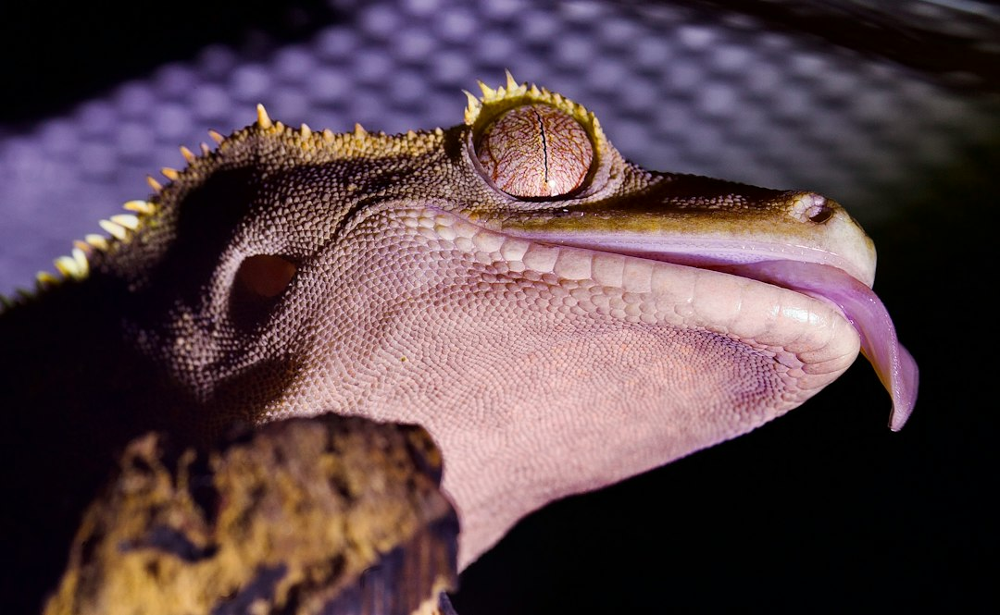

*This post contains affiliate links. As an Amazon Associate, I earn from qualifying purchases at no extra cost to you.*

Most crested gecko care advice is written to solve a cold problem: how to keep a tropical animal warm enough. In a warm climate, the real danger runs the other way. A crested gecko at 72-78°F is comfortable. The same gecko in a glass enclosure at 86°F, in a room with no airflow and a sun-warmed window, is on a path toward dehydration, refusal to eat, and in the worst cases death. The margin between "fine" and "emergency" is smaller than most keepers expect.

The position of this guide is simple: cool the room, not just the enclosure. Misting a hot tank, parking a fan against the glass, or tossing in a frozen bottle can help in a pinch, but none of them fix a room that sits at 85°F all afternoon. Keepers in Texas, Florida, Arizona, and similar climates who treat summer as a separate husbandry season, with its own thresholds, monitoring, and backup plan, are the ones who get through July without a vet visit.

Below you will find the temperature limits that matter, the early signs of heat stress, cooling methods ranked by effectiveness, a humidity strategy that avoids a stagnant swamp, and a monitoring setup that warns you before trouble starts.

Photo by <a href="https://unsplash.com/@anritikhon?utm_source=artlines_blog&utm_medium=referral">Andrey Tikhonovskiy</a> on <a href="https://unsplash.com/?utm_source=artlines_blog&utm_medium=referral">Unsplash</a>

> **Safety note:** Heat emergencies move fast, and so can electrical mistakes. Keep every plug, controller, and extension cord away from water and mist, use a GFCI-protected outlet where possible, and never exceed the wattage rating of a controller or power strip. If your air conditioning struggles or fails during a heat wave, have a licensed HVAC technician inspect it, and if you use any fuel-burning appliance or backup heating in the home, confirm your carbon monoxide detectors are working. For a gecko that is gaping, limp, or unresponsive, contact an exotic veterinarian immediately.

## Summer Husbandry for Crested Geckos Starts With Hard Temperature Limits

Crested geckos come from the southern islands of New Caledonia, where they live in a cooler, humid, forested environment. They are not desert reptiles and they do not need a basking spot. Commonly cited care guidance puts the target range at roughly 72-78°F, tolerates brief dips into the mid-60s, and treats sustained readings above about 80°F as a warning. Because they are small, nocturnal, and arboreal, they cannot retreat into a burrow or soak in a cool pool the way larger reptiles can. Whatever the air does, they live in it.

Measure where the gecko actually lives. A thermometer on the floor reads cooler than the upper third of the enclosure, where geckos spend much of their time and where hot air collects. Place your sensor at mid-to-upper height in the shade of foliage, not touching glass and not in direct light.

The table below is a working decision framework. Treat it as a set of action triggers, not a description of ideal conditions.

| Enclosure air temperature | Status | What to do |
|---|---|---|
| Below 65°F (18°C) | Too cool | Slows digestion and appetite; correct if it persists for days |
| 65-71°F (18-22°C) | Acceptable | Fine for nights and short periods |
| 72-78°F (22-26°C) | Target | No action needed |
| 79-82°F (26-28°C) | Watch zone | Increase airflow, move the enclosure, begin cooling the room |
| 83-85°F (28-29°C) | Stress risk | Active cooling now, reduce handling and feeding disruption |
| 86°F and above (30°C+) | Emergency | Move the gecko to a cooler space, check hydration, call a vet if symptoms appear |

Two points make this table practical. First, duration matters. A one-hour spike to 82°F on a hot afternoon is a different situation from three days at 82°F. Second, nighttime relief matters enormously. A gecko that reaches 84°F at 4 p.m. but cools to 74°F by midnight has a recovery window. A gecko in a room that never drops below 82°F does not, and cumulative dehydration builds quickly.

For the year-round baseline, the [Crested Gecko Humidity And Temperature Management Guide](/2026/06/15/crested-gecko-humidity-and-temperature-management-guide/) covers day and night ranges. This post focuses on what changes when the thermometer climbs.

## Recognizing Crested Gecko Heat Stress Before It Becomes an Emergency

Heat stress rarely announces itself with a dramatic collapse. It starts as a pattern of small changes, and the keepers who catch it early know what normal looks like for their animal. A gecko that is usually out on the branches at dusk and suddenly stays low in the enclosure is telling you something.

### Early signs

- **Behavior shifts:** hiding on the floor or in the cooler corners, unusual restlessness, or climbing to the mesh top and staying there.
- **Appetite drop:** skipping meals for several nights in a row during a hot spell.
- **Pale or washed-out color:** a gecko that is usually fired up at night appearing dull or faded.
- **Reduced activity at night:** less climbing, jumping, and exploring.

### Advanced signs

- **Open-mouth breathing or gaping:** an animal panting to shed heat. This is a red flag, not a quirk.
- **Sunken eyes, wrinkled or loose skin, and a thin tail base:** signs of dehydration, which usually accompany heat problems.
- **Weakness or poor grip:** dropping from branches or failing to hold on to the glass.
- **Lethargy that does not improve after cooling:** the problem has progressed beyond simple discomfort.

Thick, sticky saliva or stringy mucus around the mouth can also point to dehydration. None of these signs is a diagnosis on its own, since illness, shedding, and parasites can look similar. The [Crested Gecko Molting Problems Troubleshooting And Solutions](/2026/09/28/crested-gecko-molting-problems-troubleshooting-and-solutions/) guide is useful for ruling out a stuck shed that may be mimicking some of these behaviors.

If you suspect heat stress, respond calmly. Move the gecko, in a secure ventilated container or the enclosure itself, to the coolest room in the house. Lightly mist the leaves so the gecko can drink droplets, which is how crested geckos naturally hydrate. Do not submerge the animal, use an ice bath, or place it on a cold surface, since rapid cooling can cause shock. Do not syringe water forcefully into the mouth. Offer a shallow water dish and a gel-style meal replacement, and watch closely. If the animal is gaping, limp, or unresponsive, call a reptile-savvy vet right away. The Association of Reptile and Amphibian Veterinarians maintains a [veterinarian finder at ARAV](https://www.arav.org/) to help locate qualified exotic animal care, and the [Merck Veterinary Manual's reptile section](https://www.merckvetmanual.com/exotic-and-laboratory-animals/reptiles) explains how reptiles regulate body temperature and why overheating and dehydration are so dangerous.

## Cool the Room First, Then Fine-Tune the Enclosure

Enclosure-level tricks fight against the room. Room-level cooling changes the starting point for everything else, so the most reliable summer upgrade is almost always a cooler place to keep the gecko.

### Room-level fixes

**Move the setup.** Interior rooms, basements, and ground-floor spaces stay cooler than top-floor bedrooms or anything with a sun-facing window. If you can, relocate the enclosure for June through September. If you keep multiple animals, the planning in [How To Set Up A Dedicated Reptile Room](/2026/07/29/how-to-set-up-a-dedicated-reptile-room/) applies directly, since a room with its own cooling and monitoring is the most dependable answer to a hot climate.

**Block solar gain.** Close blinds or use blackout curtains on windows that get afternoon sun. A glass enclosure in a sunny window behaves like a greenhouse, and temperatures can climb well past what the room thermostat shows.

**Use the air conditioner strategically.** Setting the room to 74-78°F is usually enough. A house set to 80°F "to save money" while you are at work may put the gecko in the watch zone for eight hours a day. A programmable or smart thermostat can hold a safe ceiling, and the extra electricity is cheap compared with a vet bill.

### Enclosure-level fixes

**Turn off summer heat sources.** Heat mats, ceramic emitters, and heat lamps are unnecessary for crested geckos in a warm room, and a surprising number of overheating cases involve a heater that was never unplugged. Disconnect it.

**Improve ventilation.** Screen-top enclosures and models with large mesh panels shed heat better than mostly solid glass. Cross-ventilation is the goal, with air entering low and leaving high. If you use a fan, aim it across the room or at a wall, not directly into the tank, because a direct blast dries out the enclosure and the animal.

**Use external cooling aids.** A frozen water bottle wrapped in a towel and placed near the enclosure, not inside it, can shave a few degrees off the immediate air temperature during an outage or short peak. This is a stopgap, not a solution. Never leave ice or frozen items where the gecko can contact them directly.

**Add shade and cover.** Dense foliage, cork flats, and hides on the cooler side give the gecko somewhere to lower its temperature. Place them low and in the shade, since cooler, more humid microclimates tend to form near the substrate.

### A heat wave plan you can follow

When the forecast shows several days at or above 95°F, follow this sequence rather than improvising on the hottest afternoon.

1. **Check your cooling two days ahead.** Confirm the air conditioner works, replace dirty filters, and test the enclosure's sensors so you can trust your readings.
2. **Pick the coolest room and prepare it.** Clear a spot away from windows and exterior walls, and set up a power source that is separate from your main cooling circuit if possible.
3. **Turn off every heating device.** Unplug heat mats and bulbs, and remove any basking fixtures from the enclosure area.
4. **Increase airflow and reduce solar exposure.** Close blinds, open an interior door for air exchange, and use a room fan pointed away from the tank.
5. **Verify temperature at gecko level, twice a day.** Check the reading at midday and again at night, and record the highest and lowest values.
6. **Escalate when you hit 83°F.** Move the animal to the coolest space available, increase water availability, and prepare to contact a vet if symptoms appear.

## Humidity and Hydration Without Creating a Hot, Stagnant Tank

A closed tank at 82°F with constant misting is a bacterial growth chamber. Crested geckos need humidity cycles, not a permanent steam bath. The healthiest pattern is a damp evening, when the gecko is active and drinking, followed by a drying period during the day, ideally with humidity falling toward 50 percent. Staying wet around the clock combined with heat invites skin and respiratory trouble, and the [Crested Gecko Respiratory Infections And Eye Health Prevention](/2026/10/09/crested-gecko-respiratory-infections-and-eye-health-prevention/) guide covers what that looks like when it goes wrong.

In summer, adjust your routine in three ways:

- **Mist at dusk and again lightly at dawn, not at peak heat.** Spraying at 3 p.m. in a hot room adds humidity without giving the gecko a useful drinking window, and it does not cool the air in any meaningful way.
- **Keep a clean water dish available at all times.** Many crested geckos drink from droplets, but a shallow, stable dish adds a safety net during hot spells. Change it daily.
- **Watch ventilation as closely as you watch humidity.** If condensation lingers all day and the glass stays wet, you are over-misting or under-venting.

An automatic misting system keeps your schedule consistent when your own days are chaotic. An option like the [Exo Terra Monsoon Nano Misting System](https://www.amazon.com/dp/B0DJT2R8XY?tag=scaledkeeper-20) may be worth considering for a crested gecko setup. Confirm on the product listing that the fittings and nozzle placement suit your specific enclosure before buying, and set the schedule yourself rather than relying on any default. A dusk-weighted program of short cycles that lets the enclosure dry between them is a better summer pattern than long sessions. For a deeper comparison, see [Best Automatic Misting Systems For Crested Gecko Humidity Control](/2026/09/25/best-automatic-misting-systems-for-crested-gecko-humidity-control/).

Automation should never become an excuse to stop looking. Nozzles clog, reservoirs run dry, and timers fail. Check output visually once a week, and check the reservoir before any heat wave.

Finally, feed with hydration in mind. Prepared crested gecko diet mixed to a slightly wetter consistency can help in hot weather, though you should follow the manufacturer's mixing directions and discard uneaten food promptly because spoilage accelerates in heat. The same applies to live feeders: remove leftovers by morning. The [Crested Gecko Feeding Schedule Portions And Feeding Frequency By Age](/2026/10/02/crested-gecko-feeding-schedule-portions-and-feeding-frequency-by-age/) guide has the baseline portions to work from.

## Monitoring and Automation for Heat Stress Prevention

Most overheating cases are not caused by ignorance. They happen because nobody noticed the temperature climbing while the keeper was at work. A single reading at breakfast tells you nothing about 4 p.m. Reliable summer monitoring has three layers: a sensor that logs, an alert that reaches you, and a control that acts when you cannot.

**Logging and alerts.** A Bluetooth sensor like the [Govee Indoor Hygrometer Thermometer H5075](https://www.amazon.com/dp/B07Y36FWTT?tag=scaledkeeper-20) records temperature and humidity and, according to the listing, stores data you can export, with smart alerts you can set through the app. For heat season, set the upper alert at 80°F so you get a warning while there is still time to act. The logged history is the real value: a week of data shows which hours cause trouble, which tells you whether the fix is a curtain, a relocation, or a schedule change. Bluetooth sensors connect to your phone within a limited range, so check whether the model you buy needs a separate gateway for alerts when you are away from home. For more, see [How To Monitor Reptile Enclosure Remotely](/2026/08/05/how-to-monitor-reptile-enclosure-remotely/).

**Automated control.** A dual-stage controller such as the [Inkbird ITC-608T Temperature and Humidity Controller](https://www.amazon.com/dp/B07GQWY9HM?tag=scaledkeeper-20) is described in its listing as a dual-stage thermostat rated for 120VAC at 15A and 1800W and ETL listed. In summer, the practical use is the cooling side: if your setup allows, a sensor placed at gecko level can trigger a ventilation fan when the enclosure or cabinet reaches a set temperature, while the heating side can act as a safety net on cooler nights. Two cautions apply. First, check the load of whatever you plug in against the controller's rating, and be careful with devices that have motors or compressors, since startup draw can exceed running wattage. Second, a controller is not a substitute for room cooling. It can manage a fan, but it cannot make a 90°F room safe.

For a wider look at hardware options, [Best Thermostats And Temperature Monitoring For Precise Reptile Enclosure Contro](/2026/11/04/best-thermostats-and-temperature-monitoring-for-precise-reptile-enclosure-contro/) compares the main choices.

**Placement matters.** Put the probe or sensor at mid-height in the shade, away from direct airflow, glass, and light fixtures. Verify at least once with a second thermometer so you know your readings agree, and write down where the sensors sit so you can replace them identically after cleaning.

## Common Summer Mistakes That Cause Heat Problems

Most summer losses trace back to a short list of avoidable errors. Check yourself against these before the hot season begins.

- **Leaving winter heating equipment connected.** A heat mat that was useful in January can add several degrees in July. Disconnect and store it.
- **Placing the enclosure in sunlight.** Even a few minutes of direct sun through glass can push temperatures into the danger zone, and you will not see it happen if you are out of the room.
- **Trusting the room thermostat instead of enclosure readings.** The house may read 77°F while the upper level of a closed glass tank reads 84°F.
- **Over-misting a hot, closed enclosure.** Extra water does not cool the animal and can create conditions for bacteria and respiratory trouble.
- **Aiming a fan directly into the tank.** This dehydrates the animal and the enclosure, and it can mask a real temperature problem.
- **Using ice or cold water for emergency cooling.** Rapid chilling can cause shock. Move the gecko to a cooler room and cool gradually.
- **Transporting a gecko in a parked car.** Vehicle interiors can reach lethal temperatures within minutes, even with the windows cracked. If you must transport, keep the air conditioning running and the container shaded, and never leave the animal unattended.
- **Skipping a power outage plan.** Heat waves and grid strain often arrive together. Know where you would take the gecko if the power failed for six hours, and keep a battery fan or a cooler location ready.
- **Ignoring the first symptoms.** A gecko that skips a few meals during a heat wave deserves attention, not a "wait and see." Dehydration compounds quickly in a small animal.

The fix is rarely expensive. It is usually a matter of moving, unplugging, or adjusting one thing today.

## FAQ

### What temperature is too hot for a crested gecko?

Sustained readings above about 80°F deserve action, and anything at 85°F or higher is a real risk, particularly if the room does not cool overnight. Brief peaks are survivable, but duration and lack of overnight recovery turn discomfort into dehydration and organ stress. Many keepers treat 90°F as potentially fatal, even over a short period. Because enclosure temperatures differ from room temperatures, measure at the height where your gecko actually spends time.

### Can I keep my crested gecko without air conditioning?

It is possible in mild summers or in a naturally cool basement or interior room, but it is a risk in genuinely hot climates. Without air conditioning, you depend on the weather staying below the danger zone, and you cannot control that. If your home regularly exceeds 80°F indoors, relocating the gecko to the coolest space, blocking sun, and improving ventilation can help, but a dependable cooling source is the safer answer. Keepers in hot regions often choose a single room with a window unit or mini-split specifically for their animals. Keep a monitoring setup running regardless.

### Is it safe to use a fan on a crested gecko enclosure?

Yes, with the right placement. A fan that moves air through the room or across the outside of a screen top improves ventilation and helps shed heat. A fan blowing directly into the enclosure dries out the humidity gradient, stresses the animal, and can hide a rising temperature. Aim it at a wall or across the room so the airflow is indirect, and keep misting on a schedule so the enclosure still gets its humid evening period. Keep the fan and cords protected from mist and water, and avoid running multiple devices on a single overloaded outlet.

### How do I cool a crested gecko during a power outage?

Move the animal to the coolest area of your home, usually a lower floor, interior room, or shaded basement. Close curtains, open interior doors for airflow, and run a battery-powered fan across the room rather than at the gecko. A frozen water bottle wrapped in a towel can sit near the enclosure, never inside it or touching the glass directly. Lightly mist for drinking water and offer a shallow dish. If temperatures are headed above 85°F with no relief in sight, consider staying with a friend or relative who has cooling, transporting the gecko in a shaded, ventilated container with air conditioning running.

## Conclusion

Summer husbandry for crested geckos comes down to a short list of habits: keep the room under 78°F where possible, treat 80°F as a warning and 85°F as an emergency, unplug unneeded heat sources, mist at dusk rather than at peak heat, and monitor with alerts so a hot afternoon never goes unnoticed. Add a written heat wave and power outage plan, and you have covered the most common causes of summer losses.

Your next action is concrete. Tonight, place a sensor at gecko level, set the high alert to 80°F, and check last week's high reading. If the data shows the enclosure drifting past 80°F in the afternoon, move the setup or add room cooling before the next heat wave arrives.

Bookmark this guide for the next forecast spike, and subscribe by RSS to get the next husbandry post as soon as it goes live.

**Related reading**

- [Best Thermostats And Temperature Monitoring For Precise Reptile Enclosure Contro](/2026/11/04/best-thermostats-and-temperature-monitoring-for-precise-reptile-enclosure-contro/)
- [Crested Gecko Humidity And Temperature Management Guide](/2026/06/15/crested-gecko-humidity-and-temperature-management-guide/)

  
<strong>About the Author</strong>

  
The Scaled Keeper team researches reptile husbandry with a focus on gecko and lizard care. Our guides synthesize keeper community data, veterinary sources, and documented husbandry outcomes - so you can make informed decisions for your animals.

