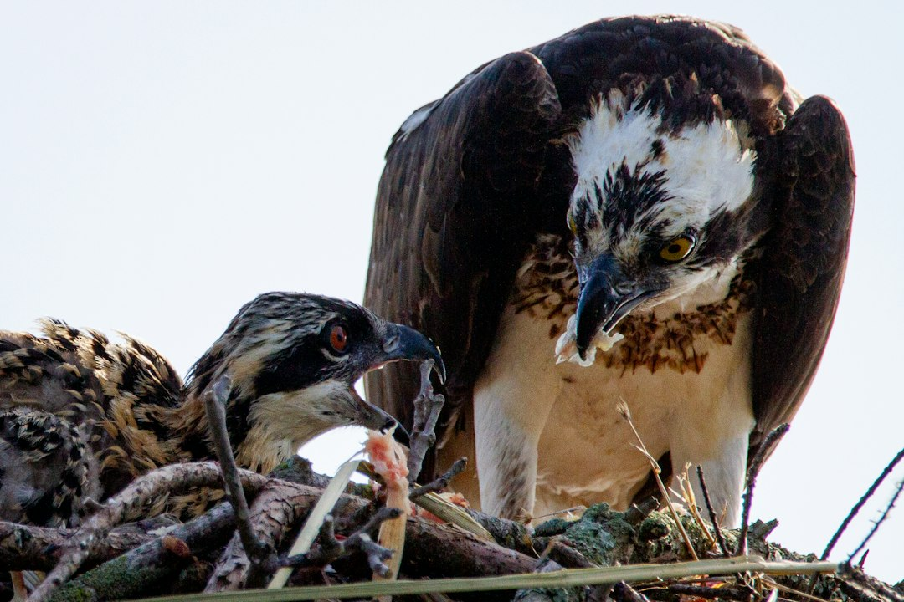

*This post contains affiliate links. As an Amazon Associate, I earn from qualifying purchases at no extra cost to you.*

Most crested gecko keepers never face a live versus pre-killed prey decision for daily feeding, because the staple diet is a powdered complete gecko diet (CGD) mixed with water. The question appears when you add insects for variety, enrichment, or to coax a thin gecko into eating more. At that point the method matters more than most care sheets admit. Live insects trigger a natural hunting response and arrive with their nutrition intact, but they bite, escape, and need housing of their own. Pre-killed prey is tidier and safer for the gecko, yet many crested geckos simply ignore food that does not move.

Here is the short version. For a healthy adult, small and well-fed live insects offered in a controlled way are the better supplement. Pre-killed or freeze-dried options are the right fallback for injured animals, travel, and keepers who cannot stomach a cricket colony. Neither replaces CGD. The rest of this guide compares the two approaches on safety, nutrition, and convenience, shows which one fits your situation, and walks through exactly how to run each without creating new problems.

Photo by <a href="https://unsplash.com/@jcotten?utm_source=artlines_blog&utm_medium=referral">Joshua J. Cotten</a> on <a href="https://unsplash.com/?utm_source=artlines_blog&utm_medium=referral">Unsplash</a>

## Why Live Versus Pre-Killed Prey Matters for Crested Geckos

Crested geckos (*Correlophus ciliatus*) are omnivores that eat fruit, nectar, and insects in the wild. In captivity, CGD formulas are designed to cover the nutritional baseline, which is why keeper and veterinary sources generally treat insects as a supplement rather than the foundation of the diet. The guide to [which live insects to feed crested geckos and how to culture them](/2026/09/18/which-live-insects-to-feed-crested-geckos-and-how-to-culture-them/) covers species selection and colony care. This article focuses on the delivery method.

The terms get blurred online, so here is how they are used in this guide:

- **Live prey:** insects that are alive and moving when the gecko encounters them.
- **Pre-killed prey:** insects killed shortly before feeding, usually by chilling and then freezing, or by crushing the head. They are offered fresh or after thawing.
- **Freeze-dried or canned prey:** shelf-stable insects sold dead and dried or preserved.

The distinction matters because crested geckos hunt largely by movement. A gecko that happily lunges at a cricket on a tweezer tip may walk past the same cricket lying still in a dish. That single behavioral fact explains most of the practical tradeoffs below.

Three variables decide which method wins in your setup. **Safety** covers injury to the gecko, escapes, and hygiene for you. **Nutrition** covers moisture, gut-loading, and how well calcium dust sticks. **Convenience** covers storage, cost, and how much daily effort you are willing to spend.

> **Safety note:** Reptiles and their enclosures can carry Salmonella, and the [CDC's healthy pets guidance](https://www.cdc.gov/healthy-pets/) recommends washing hands thoroughly after handling reptiles, feeders, or anything from the enclosure. Never feed wild-caught insects, which can carry pesticides and parasites. If your gecko is lethargic, losing weight, or has trouble using its jaw or tail, contact an exotics veterinarian instead of adjusting the feeding method alone. The [Association of Reptile and Amphibian Veterinarians](https://arav.org/) is a good starting point for finding one.

## Live Prey: What You Gain and What You Risk

### The benefits

Live insects are the closest match to natural feeding. Movement triggers the hunt, so even a gecko that is bored with CGD will often respond. The hunt itself provides light exercise and mental stimulation, which fits with the broader approach to enclosure enrichment. Live insects also carry their own moisture and whatever gut-load you fed them, which is why they remain the standard recommendation in most husbandry references.

Cost is the other advantage. A small culture of dubia roaches or a weekly purchase of crickets usually costs less per feeding than commercial pre-killed products, and a colony removes the last-minute store run. Dusting is also simple: insects shaken in a cup with calcium powder pick up an even coat.

### The risks

The downsides are real and mostly preventable. Crickets left in an enclosure can chew on a sleeping or shedding gecko, and uneaten ones hide in decor and keep chirping or fouling the substrate. Superworms and large mealworms have stronger jaws and harder exoskeletons than a juvenile gecko should deal with. Oversized insects raise the risk of regurgitation or digestive trouble, so a safe working rule is to keep every feeder no wider than the space between your gecko's eyes.

There is also the housekeeping burden. Feeder insects need their own container, ventilation, food, a water source, and regular removal of dead individuals. Odor and die-offs happen when the container is overcrowded or too humid. Escapes are a nuisance you will notice quickly in a home with other people or pets.

Finally, check your local rules. Some jurisdictions restrict certain feeder roach species, so confirm what is legal where you live before building a colony.

My view is that the benefits outweigh the risks for healthy adults, provided you use small feeders, remove leftovers promptly, and never let insects crowd out CGD.

## Pre-Killed, Chilled, and Freeze-Dried Options

### Freshly killed and chilled insects

The most common pre-killed method is chilling live insects in the refrigerator until they go dormant and then moving them to the freezer for a short period. Many keepers consider this gentler than crushing live insects, although formal research on insect welfare is limited. Thaw the insects to room temperature before feeding so the gecko is not offered something cold.

Fresh-killed insects keep most of their nutritional value for a short window, and calcium dust still adheres to them. The weak point is presentation. Because a dead insect does not move, you need to animate it, which is where tweezers earn their place. Grip the insect behind the head and wiggle it near the gecko's nose, mimicking a struggling prey item.

Head-crushed insects are a middle option for bigger feeders. Crushing the head of a larger roach or worm removes the bite risk while the body may still twitch. Be aware that this is a hands-on step some keepers dislike, and chilling is the cleaner alternative.

Discard any uneaten dead insects within a couple of hours. Dead prey spoils quickly in a warm, humid enclosure, and decaying insects are a hygiene problem you do not want in a bioactive or humid setup.

### Freeze-dried and canned insects

Freeze-dried insects are the most convenient option on the market. They store at room temperature, never escape, and need no culture. The tradeoffs are low moisture and weak motivation: most crested geckos will not chase a dry, still object, and dry food can be less appealing than CGD that is already moist. Soaking them briefly in warm water to rehydrate them improves both texture and appeal. Check each product's label for feeding guidance, since formulas and processing vary by brand.

The [Merck Veterinary Manual's overview of reptile nutrition](https://www.merckvetmanual.com/exotic-and-laboratory-animals/reptiles/nutrition-in-reptiles) notes that feeder insects are nutritionally unbalanced unless they are gut-loaded or supplemented. That caution applies even more strongly to processed insects that cannot be gut-loaded at all. Treat freeze-dried prey as an occasional treat or a backup, not a regular protein source.

A shallow, stable dish keeps rehydrated or dead insects off the substrate. The [Zoo Med Combo Reptile Rock Food and Water Dish, Medium](https://www.amazon.com/dp/B000634LYM?tag=scaledkeeper-20) is sold as a combined food and water dish, which may suit a ledge-mounted setup where you also offer CGD. Check the dish size against your gecko's size and your ledge before buying.

## Live Versus Pre-Killed Prey: Comparison Table and Decision Framework

The table below summarizes how the three approaches compare. The ratings are general patterns, not guarantees, because individual geckos vary widely in how they respond.

| Factor | Live prey | Pre-killed (chilled or crushed) | Freeze-dried or canned |
|---|---|---|---|
| Gecko interest | Highest, movement triggers the hunt | Moderate, needs tweezers or motion | Lowest, often ignored unless rehydrated |
| Nutrition | Best when gut-loaded and fresh | Good if fed soon after killing | Reduced moisture, cannot be gut-loaded |
| Injury risk to gecko | Bites, stress, overnight chewing | Very low | Very low |
| Housekeeping | Containers, escapes, die-offs | Freezer space, quick prep | Minimal, shelf-stable |
| Typical cost | Usually lowest per feeding | Similar to live | Usually highest per feeding |
| Best use | Healthy adults, enrichment | Injured, shedding, or bite-prone situations | Travel, backup, occasional treats |

The table points toward a simple decision framework. Work through these questions in order:

- **Is your gecko healthy, adult, and eating CGD well?** Offer small live feeders once or twice a week as enrichment, using the [crested gecko feeding schedule](/2026/10/02/crested-gecko-feeding-schedule-portions-and-feeding-frequency-by-age/) as a baseline.
- **Is it a hatchling, recovering from illness, or in the middle of a shed?** Choose pre-killed prey or skip insects for now. A stressed or weak gecko should not have to fight its food.
- **Does it ignore dead prey?** Do not force the issue. Use live feeders with tweezers, or accept that CGD alone is a complete option.
- **Can you maintain a container or colony?** If not, buy a small weekly quantity, or use pre-killed options.
- **Are you traveling or relying on a pet sitter?** Freeze-dried or pre-portioned frozen insects remove the need for someone else to handle live feeders.

A hybrid approach works best for most keepers: live feeders as the default, a small stash of pre-killed insects for the exceptions.

## How to Feed Insects Safely, Step by Step

This routine works for both live and pre-killed feeding with minor changes. Follow it in order.

1. **Pick the right size.** Choose insects no wider than the space between your gecko's eyes. For hatchlings and small juveniles, that means pinhead crickets or small roach nymphs. When unsure, go smaller.
2. **Gut-load the insects.** Feed them nutritious produce or a commercial gut-load for 24 hours before feeding. A ventilated holding container makes this easier. The [NANEEZOO Cricket Keeper](https://www.amazon.com/dp/B0DS3T8SCD?tag=scaledkeeper-20) is listed with a feeding dish, a transparent body, and dispenser tubes. Confirm that the ventilation and lid suit the species you keep, since escape-proofing depends on the insect.
3. **Dust lightly.** Place the number of insects you plan to offer into a small cup with a pinch of calcium powder and shake gently. Follow the dusting frequency from your supplement label or veterinarian, and do not coat every feeding.
4. **Choose your presentation.** For live insects, either release a few in a smooth-sided dish or hold one with feeding tweezers. For pre-killed insects, tweezers are the better tool. The [Exo Terra Stainless Steel Tweezers](https://www.amazon.com/dp/B001B5ATYA?tag=scaledkeeper-20) are listed with soft-coated tips, which helps avoid scraping your gecko's mouth during a strike.
5. **Offer in the evening.** Crested geckos are most active after dark. Wiggle the insect at nose level, give the gecko a moment to focus, and let it make the strike.
6. **Watch and remove leftovers.** Stay for 15 to 30 minutes. Remove any live insects the gecko did not eat, and discard uneaten dead insects within a couple of hours.
7. **Clean up.** Wash the tweezers and dish with hot, soapy water, then wash your hands thoroughly before touching anything else.

If your gecko strikes and misses repeatedly, keep sessions short. Frustration and stress can reduce appetite across the board. A scale is useful for confirming that your feeding plan is not affecting body weight, and the guide to [gram scales for weighing geckos](/2026/08/16/best-gram-scales-for-weighing-geckos-and-small-reptiles/) covers what to look for.

## Common Mistakes and Problems to Avoid

Most feeding problems come from a handful of repeated errors. Check your routine against this list before assuming your gecko is the problem.

- **Oversized feeders.** A large superworm or adult cricket is a bite and digestion risk. Stick to the width-between-the-eyes rule.
- **Leaving live crickets in overnight.** Crickets can chew a sleeping or shedding gecko. Remove leftovers the same night, and never add insects to an enclosure with a freshly shed or injured animal that cannot get away.
- **Treating insects as the staple.** Feeder insects have an imbalanced calcium-to-phosphorus ratio unless supplemented. CGD should remain the base of the diet, with insects as an addition.
- **Feeding wild-caught or found-dead insects.** Wild-caught insects can carry pesticides and parasites, and insects that died on their own may have died of disease or be spoiled. Only use insects you killed yourself, shortly before feeding.
- **Letting dead prey sit.** Uneaten dead insects spoil quickly in humid conditions. Remove them within a couple of hours.
- **Quitting after one refusal.** A gecko that ignores a dead cricket on Tuesday may take it on Friday with better tweezer technique, a different insect, or a calmer evening. Vary the insect type and presentation before concluding that pre-killed prey will not work.
- **Skipping hygiene.** Wash your hands and tools every time. Reptile-associated Salmonella is a genuine risk, particularly for young children and anyone immunocompromised.
- **Ignoring weight and body condition.** If your gecko is losing weight or refusing food for more than a couple of weeks, the cause is rarely the feeding method. Husbandry problems such as temperature, humidity, or illness need investigating, and a vet visit is warranted.

When refusal persists, check enclosure conditions first. The [humidity and temperature management guide](/2026/06/15/crested-gecko-humidity-and-temperature-management-guide/) is a good diagnostic starting point.

## Frequently Asked Questions

### Can a crested gecko live on insects alone?

No. A diet of only insects is a common route to calcium deficiency and metabolic bone disease, because feeder insects are naturally low in calcium and high in phosphorus unless you supplement them carefully. Crested geckos are omnivores that also eat fruit and nectar, and a quality CGD is formulated to provide that balance. Insects work best as a supplement to CGD, offered once or twice a week to adults and tailored to the individual animal's age and body condition. If you are considering reducing CGD for any reason, discuss it with an exotics veterinarian first, because gradual dietary changes can still cause weight loss.

### Are insects that died on their own safe to feed?

Do not feed them. An insect found dead in the container may have died hours or days earlier, and you cannot tell whether it died of disease, dehydration, or spoilage. Bacteria multiply quickly on dead insects, and a gecko eating spoiled prey risks digestive upset. If you want pre-killed feeders, kill healthy insects yourself shortly before feeding, using a chilling method, and offer them promptly. Frequent die-offs in a feeder container also suggest overcrowding, excess moisture, or poor ventilation, so fix those conditions rather than feeding the casualties.

### How often should I offer insects?

For healthy adults, one or two small sessions per week is a common pattern, with just a few appropriately sized insects each time. Juveniles may take them somewhat more often, while hatchlings generally do best with CGD as the focus. The right frequency depends on body condition, so track your gecko's weight and adjust. If the gecko gains too much weight or starts refusing CGD in favor of insects, reduce the insect portion. Your veterinarian can give age-specific guidance, and the feeding schedule guide on this site provides a useful baseline for portions and timing.

### Are freeze-dried insects a good substitute for live ones?

They are a reasonable backup but a weak replacement. Freeze-dried insects store easily and remove the risk of bites and escapes, but they lack moisture, cannot be gut-loaded, and do not trigger a hunting response. Many crested geckos ignore them unless they are rehydrated and moved with tweezers. Use them for travel, emergencies, or occasional variety, and read the product label for feeding guidance. If your gecko takes them eagerly, treat them as a snack rather than a regular protein source, because they do not carry the same nutritional profile as fresh feeders.

## Conclusion

For most healthy crested geckos, live feeders in small sizes, offered briefly and cleaned up promptly, give the best mix of nutrition and engagement. Pre-killed prey is the safer, tidier choice for hatchlings, recovering animals, and keepers who do not want live insects in the house, and freeze-dried products fill the gap when you are away. The best setup uses both, with CGD as the constant base.

Your next step is simple. This week, choose one method, buy a small quantity of correctly sized insects, and run the seven-step routine above once. Weigh your gecko before and after a few weeks, and adjust based on what the scale and the gecko tell you.

Bookmark this guide for your next feeding-day decision, or leave a comment about which method your gecko prefers.

**Related reading**

- [Which Live Insects To Feed Crested Geckos And How To Culture Them](/2026/09/18/which-live-insects-to-feed-crested-geckos-and-how-to-culture-them/)
- [Crested Gecko Feeding Schedule Portions And Feeding Frequency By Age](/2026/10/02/crested-gecko-feeding-schedule-portions-and-feeding-frequency-by-age/)

  
<strong>About the Author</strong>

  
The Scaled Keeper team researches reptile husbandry with a focus on gecko and lizard care. Our guides synthesize keeper community data, veterinary sources, and documented husbandry outcomes - so you can make informed decisions for your animals.

