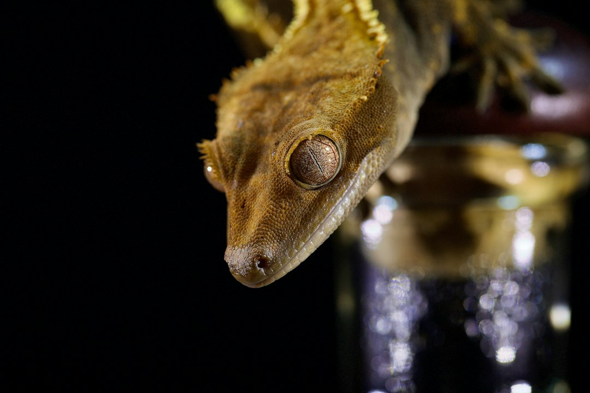

*This post contains affiliate links. As an Amazon Associate, I earn from qualifying purchases at no extra cost to you.*

Most crested gecko owners overspend on the wrong thing. They buy a huge enclosure for a hatchling that will struggle to find its food, or they buy a short, wide tank that wastes the one dimension this species actually uses. Then they argue about glass versus PVC without asking which one fits their room, their budget, and their humidity routine.

Here is the position this guide takes. Height matters more than floor area, an adult needs at least an 18" x 18" x 24" footprint, and the glass versus PVC decision comes down to humidity retention, weight, and how much you value a clear view. Neither material is automatically better. Glass is the better value for a single gecko in a normal room. PVC earns its higher price when you keep a larger enclosure in a dry climate or struggle to hold humidity.

The sections below cover size by life stage, why vertical space wins, how the two materials compare, and how to set up and avoid common mistakes.

Photo by <a href="https://unsplash.com/@anritikhon?utm_source=artlines_blog&utm_medium=referral">Andrey Tikhonovskiy</a> on <a href="https://unsplash.com/?utm_source=artlines_blog&utm_medium=referral">Unsplash</a>

## Crested Gecko Enclosure Size Requirements by Age

Crested geckos are arboreal, which means they live in trees and shrubs rather than on the ground. That single fact drives every sizing decision. Common husbandry guidance and most reputable care sheets agree on a rough progression, though exact numbers vary slightly between sources.

### Hatchlings and juveniles

A hatchling under roughly 10 grams does fine in a small enclosure, often a 5 to 10 gallon equivalent or a small front-opening terrarium around 12" x 12" x 12". The reasoning is practical. Babies are tiny, they eat from a shallow ledge, and in a very large space they can have trouble finding food, water, and the humid zones. Small enclosures also make it easier to spot a missed meal or a thin tail base, which matters when you are tracking early growth.

Plenty of keepers skip the baby tank entirely and raise a juvenile in a full-size setup with dense foliage and clutter. That works if you fill the space with hiding spots and keep the feeding station obvious. If you are new, the small enclosure is the lower-risk route because it reduces the number of variables while the animal is fragile. Our [crested gecko feeding schedule guide](/2026/10/02/crested-gecko-feeding-schedule-portions-and-feeding-frequency-by-age/) covers how often to offer food at each stage.

### Subadults and adults

For an adult, the widely cited minimum is 18" x 18" x 24", which is the footprint of a standard 20 to 30 gallon tall terrarium. This is a floor, not a goal. If you have the room, a 24" x 18" x 24" or larger enclosure gives the gecko more jumping lanes and gives you more room for plants and climbing branches.

Think about it in tiers:

- **Minimum for one adult:** 18" x 18" x 24"
- **Comfortable for one adult:** 24" x 18" x 36" or similar
- **Spacious or bioactive:** 36" x 18" x 18" up to 4' x 2' x 2'

One gecko per enclosure is the safe default for non-breeding keepers. Housing adults together invites stress, tail loss, and competition, and the larger enclosure does not fix a bad pairing. If you are weighing a second gecko, read our [quarantine protocols guide](/2026/10/28/quarantine-protocols-introducing-new-geckos-safely-and-disease-prevention/) before you bring anything home.

A 4-foot-long, 12-inch-tall tank technically holds a lot of gallons, but it is a poor crested gecko home. These animals climb, leap between branches, and sleep upside down on vertical surfaces. A shallow tank takes away the vertical routes they use.

Height also lets you build a temperature and humidity gradient. Warm, dry air rises and cooler, moister air settles lower, so a tall enclosure creates natural microclimates. The gecko can choose a drier upper perch at night and a moister lower zone when it needs to shed. In a shallow tank everything is the same air.

Use the vertical space deliberately. Mount cork flats or backgrounds on the back wall, add diagonal branches, and place foliage so the gecko has hiding places at the top, middle, and bottom. A common failure is a tall enclosure with a bare upper half. If the top is empty, the gecko will ignore it and you have effectively bought a smaller tank.

Front-opening doors also matter more than most buyers realize. A top-opening tank means you reach in from above, which resembles a predator approach. A front-opening door is gentler for a skittish animal and makes cleaning, misting, and feeding less disruptive. Our guide on [handling and taming a new reptile](/2026/06/19/how-to-safely-handle-and-tame-a-new-reptile/) explains why access angle affects stress.

Finally, avoid chasing gallon numbers. Gallons measure volume, not usable climbing space. A 20 gallon tall (12" x 12" x 24") and a 20 gallon long (30" x 12" x 12") hold the same volume, and only one suits a crested gecko. Always check the actual dimensions.

## Glass vs PVC: How the Two Tank Types Compare

Both materials can house a healthy adult. They behave very differently day to day, so the table below lays out the main tradeoffs before we dig into each one.

| Factor | Glass terrarium | PVC enclosure |
|---|---|---|
| Humidity retention | Lower, loses moisture through mesh and glass | Higher, panels hold humidity well |
| Insulation | Poor, glass sheds heat | Better, stable internal temperature |
| Weight | Heavy, especially large sizes | Lightweight and easier to move |
| Visibility | Excellent, see through all sides | Often limited to the front doors |
| Upfront cost | Generally lower for small sizes | Generally higher |
| Large sizes | Heavy and fragile | Practical and easy to assemble |
| Cleaning | Easy to wipe, scratches over time | Wipeable, can scratch or warp if abused |
| Best for | Single gecko, standard room | Larger setups, dry homes, humidity trouble |

### What glass does well

Glass gives you the clearest view of the animal and the plants, and most keepers use it for its price and availability. The [REPTI ZOO 18" x 18" x 24" glass terrarium](https://www.amazon.com/dp/B083NTQ66K?tag=scaledkeeper-20) is a good example of the standard adult footprint in a front-opening format with a double hinge door and top screen ventilation. It is a knock-down design, so expect to assemble it. The listing describes it as a 30 gallon tank, which lines up with the commonly cited adult minimum.

The downside is humidity. A screen top, which provides ventilation, also lets moisture escape. In a dry home you may need to mist more often or cover part of the screen with a sheet of acrylic or a foil tape section to slow evaporation. That is workable, but it is a recurring chore.

### What PVC does well

PVC panels hold moisture and temperature more consistently, which makes a stable environment easier to maintain. They are also much lighter than glass of the same size, which matters if you plan to build a large enclosure or move it. The [Reptile Habitats 4x2x2 PVC enclosure](https://www.amazon.com/dp/B0BQP7S859?tag=scaledkeeper-20) is listed as a 120 gallon option with PVC panels, glass doors, an aluminum frame, and heavy duty screen. At 4x2x2 it suits one adult with room to spare, or a bioactive build with plenty of plants.

The tradeoff is visibility. Most PVC enclosures have solid sides and back, so you see the gecko mainly through the front doors. For a nocturnal animal that hides by day this matters less than it sounds, but some keepers miss the panoramic view.

### Humidity and Ventilation in Glass Versus PVC

Crested geckos generally do best with a daily humidity cycle: a drier daytime period around 50 percent, and a night spike to roughly 70 to 80 percent with a thorough misting. They also need airflow so the enclosure dries out between mistings. Constant dampness without ventilation encourages mold and bacterial problems, and it is one factor in the respiratory issues discussed in our [respiratory infections and eye health guide](/2026/10/09/crested-gecko-respiratory-infections-and-eye-health-prevention/).

Glass terrariums with large screen tops tend to ventilate generously. That is helpful in a humid climate and a hassle in a dry one. If your home sits below 40 percent relative humidity in winter, you will likely work harder to hit the night spike. Our [humidity and temperature management guide](/2026/06/15/crested-gecko-humidity-and-temperature-management-guide/) walks through measuring and adjusting these numbers.

PVC enclosures hold humidity better, but they can swing the other way. If you mist heavily in a sealed PVC box with limited ventilation, moisture can linger. Check that the model you choose has real cross ventilation, usually screen panels on the top and a vent strip low on the front. Many PVC designs include both.

Whichever material you choose, buy a digital hygrometer with a probe and place it at mid-height, not near the mister. A single reading from a convenient spot tells you little. If you plan to automate the cycle, see our comparison of [automatic misting systems](/2026/09/25/best-automatic-misting-systems-for-crested-gecko-humidity-control/).

**Safety note:** Crested geckos usually do not need supplemental heat in a room that stays around 72 to 78 degrees Fahrenheit, and temperatures above the low 80s are dangerous. If you do add a heat source in a cold room, use a thermostat, keep cords away from wet areas, and never let a bulb or heat panel touch plastic or wood. Water and mains electricity are a hazard in every enclosure, so use drip loops and ground-fault protected outlets, and review the general electrical guidance from the [U.S. Consumer Product Safety Commission](https://www.cpsc.gov/). Our guide to [thermostats and temperature monitoring](/2026/11/04/best-thermostats-and-temperature-monitoring-for-precise-reptile-enclosure-contro/) covers the controller side.

Budget drives most real-world decisions, so be honest about the total cost, not just the sticker price. Glass is cheaper at the standard 18" x 18" x 24" size, and you do not need to overthink it. For one adult gecko in a typical room, the glass option delivers everything the animal requires. The money you save can go toward a thermostat, a quality hygrometer, and live plants.

PVC costs more, but the premium buys real benefits as the enclosure gets bigger. A 4' x 2' x 2' glass tank would be extremely heavy and fragile, while the PVC version is manageable. If you have a dedicated shelf or rack system, PVC is also easier to stack and lift. If you are planning a room full of enclosures, read our [dedicated reptile room setup guide](/2026/07/29/how-to-set-up-a-dedicated-reptile-room/) first.

Weight matters for furniture. A large glass tank with substrate, water, branches, and plants can exceed what a cheap stand supports. Check the load rating of whatever you place it on, and make sure the surface is level. Also leave space on at least one side for the front doors to swing open, since a front-opening enclosure placed flush in a corner can be awkward to service.

If you are buying a first setup and want everything bundled, compare packages in our roundup of [best crested gecko starter kits](/2026/06/17/best-crested-gecko-starter-kits/), but check each kit's enclosure dimensions against the minimums above. Many kits include a tank that is too short for an adult.

## How to Set Up Your Crested Gecko Enclosure

Once you pick the enclosure, setup order matters. Build it fully and let it stabilize before the gecko arrives.

1. **Assemble and clean the enclosure.** Knock-down glass or PVC models need to be put together according to the manufacturer's instructions. Wipe all surfaces with warm water and a reptile-safe cleaner, then rinse and let everything dry completely.
2. **Add a drainage and substrate layer.** For a simple setup, use a moisture-holding substrate. The [Exo Terra coco husk brick](https://www.amazon.com/dp/B01KV8EUBK?tag=scaledkeeper-20) is a natural coconut fiber substrate made for tropical enclosures. Spread it two to three inches deep once hydrated. Our [best substrates guide](/2026/06/19/best-substrates-crested-gecko/) covers alternatives and bioactive options.
3. **Install the climbing structure.** Mount cork bark, branches, and vines from the floor to the top. Angle several branches diagonally so the gecko can move between levels without long drops.
4. **Add foliage and hides.** Place live or artificial plants at all three heights, and put at least one hide in the upper third and one near the bottom. Dense cover reduces stress. See [enrichment and decoration ideas](/2026/10/16/enclosure-enrichment-and-decorations-for-crested-gecko-behavior-and-mental-healt/) for more.
5. **Place the food and water station.** Use a low ledge or cup mounted at mid-height with a shallow water dish nearby.
6. **Position the thermometer and hygrometer.** Place probes at mid-height and run the enclosure for a few days. Adjust misting and ventilation until the daily humidity cycle and temperature are stable.
7. **Introduce the gecko.** Only add the animal once the readings are consistent. Leave it alone for several days before attempting handling.

## Common Enclosure Size and Tank Type Mistakes to Avoid

Most problems with crested gecko housing come from a handful of repeat errors. Fix these and you avoid most of the troubleshooting later.

**Buying by gallons instead of dimensions.** A tank labeled 20 gallons can be a long, low box that suits a leopard gecko and fails a crested gecko. Verify height first, then footprint.

**Putting a hatchling in a huge, empty enclosure.** Very small geckos can lose track of food and water in a large space. Use a smaller enclosure or fill the big one with dense clutter and a clearly marked feeding spot.

**Ignoring ventilation in PVC.** Because PVC holds moisture so well, owners sometimes mist as if they were using glass. The result can be a permanently wet substrate and mold. Always check the substrate and walls before you mist again.

**Letting a glass terrarium stay too dry.** Screen tops in dry homes can drop humidity far below target. Partially cover the screen and measure with a probe hygrometer rather than guessing.

**Leaving the upper half bare.** If the top of the enclosure has no branches or foliage, the gecko will not use it. Fill the vertical space.

**Skipping a secure lid and door check.** Crested geckos are good jumpers and can slip out of a door that does not latch. Test every latch before use.

**Housing adults together to save space.** More room does not solve aggression. Individual geckos can show very different tolerance, as described in our article on [behavior and personality differences](/2026/10/21/crested-gecko-behavior-and-personality-differences-by-age-and-individual/).

**Overlooking health signals.** Sudden weight loss, stuck shed, or lethargy can point to a husbandry problem tied to the enclosure. Our [health issues guide](/2026/10/12/common-health-issues-in-crested-geckos-signs-treatment-and-prevention/) covers what to watch, and the [Association of Reptile and Amphibian Veterinarians](https://arav.org/) can help you find a qualified vet.

## Choosing the Right Crested Gecko Enclosure Size and Material for Your Situation

Use this decision framework to settle it quickly.

- **One adult, standard home, tight budget:** Choose an 18" x 18" x 24" front-opening glass terrarium. It meets the minimum size and gives the best visibility for the price.
- **One adult, dry climate or hard-to-hold humidity:** Choose PVC at 24" x 18" x 24" or larger. The panels do more of the humidity work for you.
- **Bioactive or planted showpiece:** Choose a 4' x 2' x 2' PVC enclosure or a large glass equivalent if you can handle the weight. The extra volume supports plants and cleanup crews.
- **Hatchling or new keeper:** Start with a small enclosure or a well-cluttered mid-size one, then upgrade at the juvenile stage.
- **Multiple enclosures in a rack:** Choose PVC for weight and uniform stacking.

If you cannot decide, glass at the adult minimum is the safer first purchase. You can always step up later, and a spare tank is useful for quarantine or a recovering animal.

## FAQ

### What is the minimum enclosure size for an adult crested gecko?

The commonly cited minimum for one adult is 18" x 18" x 24", which is the footprint of a typical 20 to 30 gallon tall terrarium. Height is the key number because crested geckos are arboreal and use vertical space for climbing, sleeping, and creating a humidity gradient. A larger enclosure is better if you have the space and can furnish it well. Avoid long, low tanks even when the gallon count looks generous, because they do not give the gecko the climbing routes it needs. Always check the actual measurements before buying.

### Is PVC better than glass for crested geckos?

PVC is not strictly better, but it solves specific problems. Its panels hold humidity and temperature more steadily and weigh less, which helps in dry homes and with large enclosures. Glass offers a clearer view and usually costs less at standard sizes. Either material can house a healthy adult when humidity, ventilation, and size are handled correctly. For one gecko in a normal room, glass is the better value. For a larger or dry-climate setup, PVC often saves effort and frustration over time.

### Can I keep a baby crested gecko in a big enclosure?

You can, but it takes more care. Very small geckos can struggle to find food and water in a large space, and they are harder to monitor for feeding and growth. If you use a big enclosure, fill it with dense foliage and cork, and place the feeding ledge where the baby will find it. Many keepers prefer a smaller starter enclosure and upgrade once the gecko reaches the juvenile stage. Track weight regularly either way so any problem shows up early.

### Do glass tanks hold enough humidity for a crested gecko?

Yes, with some management. Screen tops and glass walls lose moisture faster than PVC panels, so you may need to mist more often or cover part of the screen to slow evaporation. Aim for a drier day and a humid night, and verify with a probe hygrometer at mid-height. Moisture-holding substrate such as coconut fiber also helps stabilize the environment. In very dry homes, a glass tank can be harder to run than PVC, but many keepers maintain excellent conditions with it.

Choose the enclosure by dimensions, not gallons: an adult crested gecko needs at least 18" x 18" x 24", with extra height and clutter being worth more than extra floor. Pick glass if you want visibility and value for one gecko in a typical room. Pick PVC if humidity is hard to hold, if you are building a large setup, or if weight is a concern.

Your next step is simple. Measure the space you have, decide whether humidity or budget is your bigger constraint, and compare the two listed enclosures against that. Then assemble and stabilize the setup before the gecko comes home.

Bookmark this guide so you can come back to the size chart and checklist when you are ready to buy.

## Related Reading
- [Crested Gecko Humidity And Temperature Management Guide](/2026/06/15/crested-gecko-humidity-and-temperature-management-guide/)
- [Best Crested Gecko Starter Kits](/2026/06/17/best-crested-gecko-starter-kits/)

  
<strong>About the Author</strong>

  
The Scaled Keeper team researches reptile husbandry with a focus on gecko and lizard care. Our guides synthesize keeper community data, veterinary sources, and documented husbandry outcomes - so you can make informed decisions for your animals.

