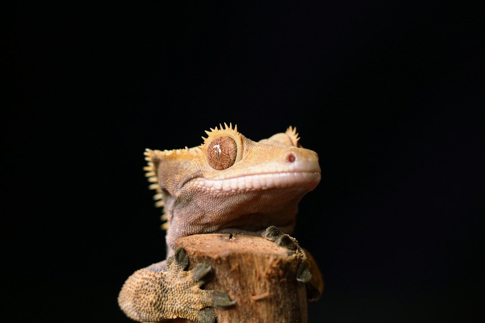

*This post contains affiliate links. As an Amazon Associate, I earn from qualifying purchases at no extra cost to you.*

Most crested gecko feeding problems are not nutrition problems. They are logistics problems. The diet is sitting in a dish that is too deep, too wide, or on the floor where it grows mold under a damp substrate. The crickets are in a deli cup that tips over. The dubia colony lives in a bin that nobody has labeled, so you cannot remember when you last cleaned it. When feeding is messy, it becomes inconsistent, and inconsistent feeding is where weight loss and picky eating start.

My position is simple: spend your attention on the cheap, boring gear. A shallow, wipeable, ledge-mounted dish and a small set of dedicated insect containers will do more for day-to-day husbandry than another bag of premium food. You need three things: a dish that suits an arboreal, nocturnal lizard, a container system that keeps feeder insects alive and contained, and a routine that ties them together.

This guide covers how to choose dishes, how to separate your insect containers by job, where a starter dubia colony fits, and how to build a feeding station you can run in five minutes a night.

Photo by <a href="https://unsplash.com/@bamin?utm_source=artlines_blog&utm_medium=referral">Pierre Bamin</a> on <a href="https://unsplash.com/?utm_source=artlines_blog&utm_medium=referral">Unsplash</a>

## Why Crested Gecko Feeding Dishes Deserve More Thought Than They Get

Crested geckos are arboreal. In the wild they forage in the canopy of New Caledonia, and in an enclosure they spend most of their active hours climbing, not walking the floor. A dish on the ground works, but it competes with substrate, moisture, and springtails for the same space. A dish mounted on a ledge or cork flat puts food where the animal naturally looks for it.

The second reason dishes matter is sanitation. Prepared crested gecko diet (CGD) is mixed with water into a paste, and that paste spoils. Product instructions from the major brands generally tell you to discard uneaten diet within about a day, so the dish you choose has to be easy to pull, scrub, and put back. A dish you dread cleaning is a dish you will clean late.

The third reason is observation. A flat, light-colored dish lets you see exactly what was eaten. Gecko lick marks, a missing scoop, or a cleared dish are your daily data points. If you track weight, that dish record pairs well with the approach in our [crested gecko feeding schedule guide](/2026/10/02/crested-gecko-feeding-schedule-portions-and-feeding-frequency-by-age/), which breaks down portions and frequency by age. A messy dish hides the very signal you are trying to read.

Finally, dishes are a safety item. Juveniles can slip into deep bowls, hatchlings can struggle to reach a ledge-height lip, and rough or cracked edges collect bacteria. Resin and ceramic with a smooth glaze are easy to disinfect. Porous, scratched plastic is not.

## Choosing the Best Crested Gecko Feeding Dishes

Look at four traits: depth, footprint, material, and how it mounts.

**Depth.** Shallow wins. A crested gecko laps paste with its tongue, so you want a rim low enough to reach comfortably and a bowl wide enough to avoid smearing the paste up the sides. For hatchlings and small juveniles, a bottle cap or a very small portion cup is often more practical than a full-size dish because it keeps the portion proportional.

**Footprint.** A small dish is easier to place on a ledge and uses less enclosure space, but a dish that is too small gets tipped. Look for a flat bottom with a wider base than the lip.

**Material.** Glazed ceramic and molded resin are the easiest to clean thoroughly. Glass is excellent but heavy and breakable, which matters on a ledge above hardscape. Soft plastic scratches and is harder to sanitize over time.

**Mounting.** Magnetic and suction ledges are popular, but a simple cork flat or a platform wedged in the branches is enough. Pick one fixed feeding spot and keep it there. Geckos learn the location, and you can stop hunting for the dish.

### The Exo Terra Feeding Dish - Medium

The [Exo Terra Feeding Dish - Medium](https://www.amazon.com/dp/B0002AR4C0?tag=scaledkeeper-20) is sold as a feeding dish, which makes it a natural candidate for adult crested geckos. Treat it as a candidate to verify rather than a guaranteed fit. Before ordering, check the listing dimensions against your ledge size and your gecko's size. A medium dish is generally better suited to adults than to hatchlings, who will do better with something smaller.

The main tradeoff is texture. Molded dishes with a rock-like surface look good but can have grooves where paste hides. Scrub with a dedicated brush and rinse well, or run through a hot-water wash routine at the end of each cleaning cycle. If the surface ever develops cracks or deep scratches, replace it.

My practical recommendation is to own two dishes per enclosure: one in use, one clean and dry. Rotating them removes the pressure to scrub the dirty one immediately, and it means a missed cleaning never leaves a bowl of spoiled paste in the enclosure overnight.

For nutrition context on what you are actually putting in the dish, our guide to [reading reptile nutrition labels and CGD ingredients](/2026/06/22/understanding-reptile-nutrition-labels-and-cgd-ingredients/) explains what to look for before you mix.

## Live Insect Containers for Crested Geckos: Three Different Jobs

Crested geckos do not need insects every day, and a healthy complete diet carries most of the nutritional load. Many keepers still offer insects as enrichment and as a protein variety, usually once or twice a week. Our breakdown of [which live insects to feed crested geckos and how to culture them](/2026/09/18/which-live-insects-to-feed-crested-geckos-and-how-to-culture-them/) covers species choices in depth. Here the question is containers, and the easiest way to avoid chaos is to assign each container exactly one job.

**Job one: the colony or bulk container.** This is where feeders live long-term. It needs ventilation, a smooth upper wall to prevent climbing escapes, hiding structure like egg crate, and enough floor area to avoid overcrowding. A lidded plastic tub with a mesh-covered vent is the standard approach.

**Job two: the working container.** This holds a few days of insects at a time. Pull out what you need for the week, put them in a small container, and keep the colony undisturbed. This reduces how often you open the colony and cuts down on escapes.

**Job three: the feeding vessel.** This is what actually goes into the enclosure. It should be a smooth-sided dish or cup, shallow enough for the gecko to reach into but too slick for the insects to climb out of. Some keepers skip the vessel and use feeding tongs instead, which is fine and arguably cleaner.

### The Zoo Med Creatures Habitat Kit, Pack of 12

The [Zoo Med Creatures Creature Habitat Kit, 12 pack](https://www.amazon.com/dp/B0771SV2W8?tag=scaledkeeper-20) may suit the second job. Small containers sold in a multi-pack can be convenient for working portions, quarantining a handful of new feeders, or separating nymph sizes; verify the listing details for lids and ventilation first. A pack of 12 also lets you label containers by purpose and stop reusing the same one for everything.

Confirm ventilation and lid fit on the listing before you rely on them for roaches or crickets. Small containers lose humidity and heat quickly, and a tight lid with inadequate airflow can sour a batch of insects fast. Treat them as short-term holding containers, not permanent colonies, unless you have verified they suit the species.

One more tip: write the date on masking tape or a removable label. A container that says "Dubia, medium, 11/20" is much easier to manage than three identical tubs of unknown age.

## Why a Dubia Colony Fits an Organized Feeding Setup

If you plan to feed insects regularly, buying from a pet store each week is expensive and creates its own mess, because you bring home a cup of insects with minimal gut-loading and a short shelf life. A small breeding colony turns this into a controlled system: you always have the right sizes, you control what they eat, and you spend less on feeders over time.

Dubia roaches are a popular choice for this because they are generally regarded as quieter and less prone to escape than crickets. They cannot climb smooth plastic well and are poor fliers, which simplifies container choice. They also tend to survive in conditions where crickets die off, and many keepers report less odor.

The [Got Feeders? Organic Live Dubia Roach Starter Breeding Colony, 15 female and 3 male](https://www.amazon.com/dp/B0B3BN8M7W?tag=scaledkeeper-20) matches the ratio many keepers use for starting a colony. As with the other items here, verify the details before purchasing: confirm the seller, the stated life stage of the roaches, and shipping conditions. It is November, so ask whether the seller uses heat packs for cold-weather shipping, because live insects arriving chilled are a common avoidable loss.

Two cautions before you commit:

- **Check local regulations.** Some states and localities restrict or regulate keeping dubia roaches. Check with your state department of agriculture or the [USDA APHIS](https://www.aphis.usda.gov/) guidance for your area before ordering.
- **Plan the space.** A colony works best warm, roughly in the 80s Fahrenheit, which usually means a dedicated shelf, a heat source with a thermostat, and a bin that is not in a cold garage. If you cannot provide stable warmth, a colony will stall. Our [feeder insect breeding colonies guide](/2026/10/26/feeder-insect-breeding-colonies-for-crested-gecko-keepers/) walks through setup and maintenance.

A starter colony is also a real time commitment. If you only offer insects a few times per month, a small purchased supply may be the simpler path. For anyone feeding insects weekly across multiple geckos, a colony is hard to beat on cost and consistency.

## Feeding Dish and Insect Container Comparison

Use this table to match the item to the job. Dimensions and ventilation vary by listing, so confirm the specifics before buying.

| Item | Best job | Strengths | Tradeoffs | Best for |
|---|---|---|---|---|
| Exo Terra Feeding Dish - Medium | CGD feeding dish on a ledge | Dish format, easy to rotate | Verify size against your ledge; may be large for hatchlings | Adults and larger juveniles |
| Bottle cap or small portion cup | CGD for hatchlings | Right-sized portions, cheap, disposable | Light, can tip; not for long-term use | Hatchlings and small juveniles |
| Zoo Med Creatures Creature Habitat Kit, 12 pack | Working containers, holding, quarantine of feeders | Multi-pack, labeling by purpose | Verify ventilation; short-term holding only | Keepers feeding insects weekly |
| Lidded bin with mesh vent | Colony container | Space, airflow, stable environment | Needs heat, hides, and regular cleaning | Anyone running a colony |
| Dubia starter colony | Ongoing feeder supply | Cost control, controlled gut-loading | Space, warmth, and local rules | Multi-gecko or frequent insect feeders |

### A quick decision framework

- **One gecko, insects only occasionally?** Skip the colony. Buy small amounts, use one of the small lidded containers for holding, and feed with tongs or a smooth dish.
- **One to three geckos, insects weekly?** A starter dubia colony plus a small set of working containers is the efficient path.
- **Breeding or a growing collection?** Go straight to a colony in a lidded bin and keep a rotating set of labeled working containers for each feeding day.
- **Hatchlings in the collection?** Add small portion cups so you do not over-portion and waste diet.

Whichever path you choose, buy for the routine you will actually keep. Gear that needs a perfect routine fails quickly.

## How to Build a Crested Gecko Organized Feeding Station

A feeding station is a single shelf or drawer where everything lives. It keeps the process fast enough that you will actually do it nightly. Follow these steps.

1. **Pick one location.** Choose a shelf near your enclosure that stays dry and out of direct sun. If you keep multiple animals, our guide on [setting up a dedicated reptile room](/2026/07/29/how-to-set-up-a-dedicated-reptile-room/) has layout ideas that keep feeding supplies away from heat sources and splash zones.
2. **Set up two dishes per enclosure.** Keep one in use and one clean and dry. Swap them daily or whenever you replace the diet.
3. **Prepare a cleaning kit.** A dedicated brush, an unscented dish soap, a small tub for soaking, and paper towels. Keep it separate from kitchen sponges.
4. **Label your containers.** Use tape or a marker to record contents, size, and date. Assign each container one job: colony, working, or quarantine.
5. **Plan insect days.** Choose fixed days, for example Tuesday and Saturday, and move the working container from the colony to the station the night before so insects can be gut-loaded and dusted.
6. **Measure and record.** Note what was eaten, what was left, and any changes. A small notebook or a spreadsheet works. If you track weight, combine it with a gram scale routine so you can spot trends early.
7. **Wash hands and tools between enclosures.** Use separate tongs or wash them between animals. This matters most when you maintain more than one gecko, since it reduces the chance of moving pathogens around. Standard hygiene guidance for reptile keepers also recommends washing your hands after handling animals, feeders, or enclosure items.

Once this is set, the nightly routine should take only a few minutes. The first week feels like extra work. After that, it should feel automatic.

## Common Feeding Dish and Insect Container Mistakes to Avoid

**Leaving diet in the enclosure too long.** Prepared diet is a moist paste, and bacteria and mold can develop. Follow the label of your chosen diet and remove uneaten food on schedule, not when you remember.

**Using deep bowls.** Deep dishes are hard for small geckos to reach into and tempt you into over-portioning. Shallow is better, and a smaller portion is better than a full dish that goes to waste.

**Placing the dish on the floor of a humid enclosure.** Floor placement invites substrate contamination and mold. A ledge keeps the dish cleaner and matches natural foraging behavior. If you need help with moisture balance, see our [humidity and temperature management guide](/2026/06/15/crested-gecko-humidity-and-temperature-management-guide/).

**Using one container for everything.** When the same tub serves as colony, holding, and feeding vessel, it gets dirty and nobody knows what is in it. One job per container solves this.

**Overcrowding the colony.** Too many insects in too little space leads to cannibalism, die-offs, and odor. Give them room, hides, and airflow, and thin the colony before it crashes.

**Skipping the lid check.** Escapes are almost always a lid or ventilation issue. Test every container before it holds live insects, and keep smooth upper walls clear of anything the insects can use as a ladder.

**Feeding oversized insects.** A common guideline is that feeder insects should be no wider than the space between the gecko's eyes. Oversized prey can cause refusal or digestive trouble, and juveniles are at greatest risk.

**Ignoring changes in appetite.** If your gecko stops eating, do not assume it is a dish problem. Persistent refusal, visible weight loss, or lethargy warrants a veterinary check. The [Association of Reptile and Amphibian Veterinarians](https://arav.org/) offers a directory to help you find a qualified vet, and the [Merck Veterinary Manual's reptile section](https://www.merckvetmanual.com/exotic-and-laboratory-animals/reptiles) provides general reference on reptile health and husbandry.

## FAQ

### What is the best feeding dish for a crested gecko?

For most keepers, the best dish is shallow, smooth, stable, and easy to sanitize, placed on a ledge rather than the floor. Glazed ceramic or molded resin is easier to clean than soft plastic. Adults can use a medium-size dish, while hatchlings and small juveniles do better with a bottle cap or small portion cup that keeps portions proportional. Whatever you choose, own two so you can rotate one in and one out. That single habit removes most of the mess and mold problems keepers run into, and it makes daily cleaning much less of a chore.

### How often should I feed insects to a crested gecko?

Crested geckos do well on a complete prepared diet, and many keepers offer insects as a supplement or treat, often once or twice a week. Offer appropriately sized insects, dust them according to your supplementation plan, and watch your gecko's weight and body condition. Insects should not replace the staple diet unless a veterinarian advises it. If you are unsure how much is appropriate for your gecko's age, review the portion and frequency guidance in our crested gecko feeding schedule article, and adjust based on weight trends rather than a rigid calendar.

### Are dubia roaches better than crickets for crested geckos?

Many keepers prefer dubia roaches because they are generally quieter, climb smooth surfaces poorly, and tend to be easier to keep alive in a colony. Crickets are widely available and cheap, but they jump, chirp, and can die off quickly in poor conditions. Neither is universally better. The right choice depends on your space, your tolerance for escape risk, and local regulations, since some areas restrict dubia keeping. Check your state's rules before buying, and choose the feeder you can keep consistently clean, warm, and well ventilated.

### How do I keep feeder insects from escaping?

Start with the container. Use a lid that fits tightly, add a mesh-covered vent for airflow, and keep the upper walls smooth and free of anything climbable. Open the colony as little as possible by using a small working container for weekly portions. When you feed, use tongs or a smooth-sided dish that insects cannot scale. Test every new container empty before using it, and check the seal regularly, since lids warp and cracks form over time. Most escapes trace back to a lid or vent that was never tested.

### Conclusion

Good feeding gear is not glamorous, but it is the difference between a smooth routine and a daily scramble. Choose a shallow, easy-to-clean dish and rotate two per enclosure. Assign every insect container a single job. If you feed insects often, consider a starter colony, but verify your local rules, your warmth, and your seller before you buy. Then tie it all together with one labeled feeding station and a short routine you can repeat every night.

Your next step: pick one enclosure this week, set up the two-dish rotation, and label every container you own with its contents and date.

### CTA

If this helped, bookmark the page so you can come back when it is time to rebuild your feeding station.

### Related reading
- [Feeder Insect Breeding Colonies For Crested Gecko Keepers](/2026/10/26/feeder-insect-breeding-colonies-for-crested-gecko-keepers/)
- [Best Calcium And Vitamin Supplements For Crested Gecko Nutrition](/2026/09/14/best-calcium-and-vitamin-supplements-for-crested-gecko-nutrition/)

  
<strong>About the Author</strong>

  
The Scaled Keeper team researches reptile husbandry with a focus on gecko and lizard care. Our guides synthesize keeper community data, veterinary sources, and documented husbandry outcomes - so you can make informed decisions for your animals.

