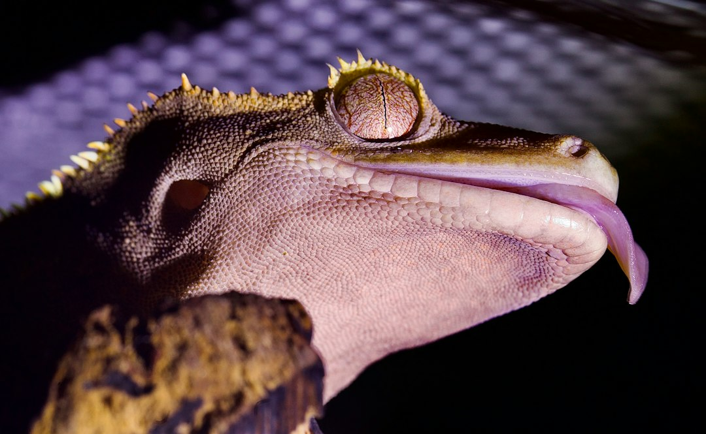

*This post contains affiliate links. As an Amazon Associate, I earn from qualifying purchases at no extra cost to you.*

Every autumn the same question appears in crested gecko groups: my gecko stopped eating and sleeps all day, is this brumation? Usually the honest answer is that crested gecko brumation is not the deep, months-long dormancy you see in a bearded dragon or a tortoise. Cresteds come from the southern islands of New Caledonia, a subtropical region with mild winters, so they slow down rather than shut down. What you are seeing is a seasonal rhythm, and you can either work with it or accidentally disrupt it.

The position here is simple. Do not try to force deep dormancy. If you want to mimic natural seasonal cycles, run a gentle, controlled cool down on a healthy adult, and treat every sudden stop in eating as a possible health problem until you have ruled it out with weight data. The difference between a resting gecko and a sick one comes down to tracked weight, reliable monitoring, and a thermostat that never lets the enclosure drift below safe limits.

This guide covers what brumation really means for this species, safe temperature targets, a step-by-step cool down plan, feeding and hydration during slow months, and the gear that makes it manageable.

Photo by <a href="https://unsplash.com/@anritikhon?utm_source=artlines_blog&utm_medium=referral">Andrey Tikhonovskiy</a> on <a href="https://unsplash.com/?utm_source=artlines_blog&utm_medium=referral">Unsplash</a>

## Does Crested Gecko Brumation Actually Happen?

Brumation is the reptile version of hibernation. In temperate species, falling temperatures and shorter days trigger a drop in metabolism, long periods of hiding, and weeks or months of fasting. The animal lives off stored fat until conditions improve.

Crested geckos (*Correlophus ciliatus*) do not face that kind of winter. New Caledonia has warm and cooler seasons, but nights rarely approach freezing at the elevations where these geckos live. As a result, there is no strong evidence that the species needs deep dormancy to stay healthy. Plenty of keepers hold cresteds at steady room temperatures all year with no ill effects.

Still, keepers regularly report seasonal changes in captive animals: smaller meals, more hiding, less climbing, and fewer cage-glass appearances from roughly late autumn through winter. The likely drivers are cooler rooms, shorter days, and the animal's own breeding cycle, though nobody has pinned down which factor dominates.

It helps to separate three states:

- **Normal winter slowdown:** eating less per night, still moving, still alert, weight stable.
- **Mild cool down:** a deliberate, small temperature and day length reduction for a healthy adult, with weight monitored.
- **Illness that looks like brumation:** weight loss, sunken hips, dull eyes, no interest in food for more than a week or two, often with other signs.

The third state is the danger. A crested gecko carries far less reserve than a larger dormant reptile, and its tail fat is a modest buffer. "He is just brumating" becomes a dangerous explanation when no one has weighed the animal.

## Setting Temperature Targets for a Crested Gecko Brumation Cool Down

Most care guidance for the species centers on roughly 72 to 78 degrees F during the day, with a natural drop at night. Heat above the low 80s is the real hazard, which is why a summer plan matters just as much; see our guide to [summer husbandry for crested geckos](/2026/11/11/summer-husbandry-for-crested-geckos-heat-stress-prevention-in-warm-climates/) for the warm end of the range.

A winter cool down simply shifts the whole curve down a few degrees. It is not a refrigerator-style chill.

| Phase | Daytime | Night | Day length | Notes |
|---|---|---|---|---|
| Normal year-round | 72-78 F | 68-72 F | 12 hours | Never exceed about 80 F |
| Gentle cool down | 68-72 F | 65-68 F | 10-11 hours | Healthy adults only |
| Hard floor | 65 F | 65 F | n/a | Raise temperatures if readings dip below this |
| Heat stress zone | 82 F and up | n/a | n/a | Cool the enclosure immediately |

Humidity should stay in the usual range, around 50 to 70 percent with a nightly spike after misting. Cooler air holds moisture differently, so a drop in temperature can make a vivarium feel damper or let it dry faster depending on ventilation. Check readings rather than assuming.

The practical logic: a night low in the mid-60s F is within what the species tolerates, and a daytime high that stays in the upper 60s to low 70s signals a seasonal change without forcing a fast. Anything colder gains you nothing and adds respiratory risk. If that concerns you, read our piece on [crested gecko respiratory infections and eye health](/2026/10/09/crested-gecko-respiratory-infections-and-eye-health-prevention/) before you lower a single degree.

## How to Run a Crested Gecko Brumation Cool Down Step by Step

Only attempt this with a healthy adult at a stable weight. If you are unsure whether yours qualifies, skip to the section on who should skip the cool down entirely.

> **Safety warning:** Every heat source in a gecko enclosure, including heat mats, ceramic emitters, and space heaters, must run through a thermostat with a probe. Never use heat rocks. Keep plugs, controllers, and cords away from misting spray, use a drip loop on cables, and plug into a GFCI outlet where possible. A stuck heater is a fire and burn risk. If an animal is cold, limp, or unresponsive, warm the room gradually and call a reptile veterinarian immediately.

1. **Confirm health first.** Weigh the gecko on a gram scale, note body condition, and check for retained shed, stuck feces, or nasal or eye discharge. If anything looks off, see a vet before cooling anything. The [Association of Reptile and Amphibian Veterinarians](https://arav.org/) offers a directory for locating one.
2. **Map the room for a week.** Place a data logger at gecko height in the enclosure and another in the room. You need to know the real swing before you change it.
3. **Install control on every heat source.** Set the thermostat to the new target rather than unplugging gear and hoping the room stabilizes.
4. **Step down gradually.** Lower the target about 2 degrees F every three to four days across roughly two weeks until you reach 68 to 72 F days and 65 to 68 F nights.
5. **Shorten the light cycle slightly.** Move from 12 hours to 10 or 11 over the same period. Crested geckos do not need UVB for survival, but a consistent day and night pattern still matters; our [crested gecko UVB guide](/2026/10/23/best-uvb-lighting-for-crested-geckos-nocturnal-needs-and-top-fixtures/) explains the optional lighting tradeoffs.
6. **Hold for four to eight weeks at most.** Many keepers aim for a few weeks only, which is plenty to show seasonal change without risking condition.
7. **Weigh weekly and log it.** If weight falls more than about 10 percent from baseline, or hip and tail fat visibly shrinks, end the cool down and warm the enclosure back up.
8. **Reverse the process slowly.** Raise targets 2 degrees every few days and restore the longer light cycle over one to two weeks.

## Feeding, Hydration, and Weight During Crested Gecko Brumation

Reduced appetite is expected during a cool down, but "reduced" does not mean "none." Keep offering food on your usual schedule. Provide a fresh portion of crested gecko diet in a ledge dish, then remove uneaten food after 24 to 48 hours because it spoils. Do not stop offering because the dish was untouched yesterday; a gecko that decides at 2 a.m. to eat should find a clean meal.

Water is non-negotiable. Mist the enclosure at least once daily and keep a shallow water dish available, since dehydration is one of the fastest ways a quiet gecko turns into an emergency. Look for wrinkled skin, sticky saliva, and sunken eyes. If you see them, end the cool down.

Weight is your single best signal. Weigh at the same time each week, ideally with an empty gut, and record the number. A trend matters more than a single reading, because feces, a recent meal, or water in the gut can swing a small gecko by a gram or two. Pair the scale with a visual check. Our [body condition score guide](/2026/08/17/crested-gecko-body-condition-score-underweight-healthy-and-overweight-examples/) shows what healthy hips and tail base look like, and our [weight loss troubleshooting article](/2026/08/19/crested-gecko-losing-weight-causes-tracking-and-when-to-call-a-vet/) explains when a decline becomes a vet call. The 10 percent figure above is a common keeper rule of thumb rather than a veterinary standard, so ask your vet what threshold suits your animal.

Do not force-feed unless a veterinarian directs it. Aspiration and stress from improper syringe feeding can do more harm than a few skipped meals.

Also resist the temptation to supplement more heavily to "make up" for the slowdown. Over-supplementing calcium or vitamins in a gecko that is eating less raises its own risks. Keep dusting and diet quality steady, as described in our guide to [crested gecko calcium and vitamin supplements](/2026/09/14/best-calcium-and-vitamin-supplements-for-crested-gecko-nutrition/).

## Gear for a Crested Gecko Brumation Cool Down

A controlled cool down depends on two things: the ability to hold a setpoint, and proof that the setpoint was held. Here is how three supplied products fit.

The [Inkbird ITC-308 Digital Temperature Controller](https://www.amazon.com/dp/B01HXM5UAC?tag=scaledkeeper-20) is a two-stage outlet controller with heating and cooling modes, rated by the listing at 1100W. That dual-mode design is the reason to prefer it for a cool down. Plug a heater into the heating side and a small fan into the cooling side, and the unit will hold a band instead of a single number. The tradeoff is that it only moves temperature relative to the room, so a fan cannot cool below ambient. Read the manual on the [Inkbird site](https://www.inkbird.com/) before wiring anything with a higher wattage.

The [Exo Terra Thermostat with Day and Night Timer](https://www.amazon.com/dp/B08R2BJMXP?tag=scaledkeeper-20) is the simpler choice when you only need a lower night setpoint. A day and night timer fits how a gecko cools naturally after dusk. Check the heater wattage against the unit's rating on the [Exo Terra site](https://www.exo-terra.com/) before plugging anything in.

The [Govee Indoor Hygrometer Thermometer H5075](https://www.amazon.com/dp/B07Y36FWTT?tag=scaledkeeper-20) is an independent check. It logs temperature and humidity over Bluetooth and, per the listing, stores up to two years of exportable data. Use it as a second opinion on the thermostat probe rather than as a controller, and place it at mid-height away from the heat source. The listing advertises 164 feet of remote monitoring, but real-world range will vary, especially through walls.

For most keepers, the best pairing is the Inkbird ITC-308 plus the Govee logger. Choose the Exo Terra alone if you only need a day and night timer for a lower night temperature in one enclosure. For a deeper comparison, see our roundup of [thermostats and temperature monitoring for reptile enclosures](/2026/11/04/best-thermostats-and-temperature-monitoring-for-precise-reptile-enclosure-contro/).

## When to Skip Crested Gecko Brumation Entirely

Plenty of geckos should not be cooled at all. Skip the cool down if your animal is:

- **A juvenile or subadult.** Growing geckos need consistent food and warmth for bone development and should not fast.
- **Underweight or recently lost weight.** Use the body condition score first and fix the cause.
- **New to your home.** Wait through your [quarantine protocol](/2026/10/28/quarantine-protocols-introducing-new-geckos-safely-and-disease-prevention/) and establish a baseline weight before experimenting.
- **A gravid female or one recently bred.** Egg production is demanding, and the risks of complications are real; see our guide to [egg binding in crested geckos](/2026/11/06/egg-binding-in-female-crested-geckos-prevention-and-emergency-response/).
- **Showing any symptoms of illness.** Cooling a sick gecko slows immune response and can hide a worsening condition.

Breeders sometimes schedule a cooler rest to condition females between seasons, and that approach is covered in our [crested gecko breeding guide](/2026/09/30/crested-gecko-breeding-guide-courtship-eggs-and-hatchling-care/). It remains optional. A pet gecko held at stable room temperature year round is not being neglected.

## Common Mistakes and Problems With Crested Gecko Brumation

**Calling every fast "brumation."** This is the biggest error. If you cannot show a stable weight trend, you do not know the cause. Weigh first, label later.

**Cooling too fast.** Dropping 8 degrees overnight is a stressor, not a season. Step down slowly and watch the animal's behavior.

**Relying on room temperature alone.** Houses swing with drafts, windows, and overnight thermostat setbacks. Without a probe in the enclosure, you may be running colder than you think, which invites the respiratory problems covered earlier.

**Letting humidity collapse.** Winter heating dries indoor air. If the enclosure only reaches 35 percent after misting, shedding problems follow; our [molting troubleshooting guide](/2026/09/28/crested-gecko-molting-problems-troubleshooting-and-solutions/) covers what to do.

**Forgetting water.** A gecko that is not eating can still dehydrate. Mist daily no matter how quiet the animal seems.

**Waiting too long to intervene.** Many keepers wait for week three of a refusal before acting. If weight is falling, do not wait. Call a vet, and review how to [find a herp vet on a budget](/2026/07/27/reptile-veterinary-care-finding-a-herp-vet-on-a-budget/) before you need one at midnight.

**Re-warming abruptly.** Jumping from 66 to 76 degrees in a day can stress a gecko that has been slow. Reverse the ramp gradually.

**Skipping the thermostat on auxiliary heat.** A space heater without control can push a small room past safe limits within hours. This is the most dangerous mistake on the list.

## Frequently Asked Questions

### How long does crested gecko brumation last?

There is no fixed duration, because crested geckos do not follow a rigid dormancy calendar. A normal winter slowdown might last a few weeks to a couple of months, with appetite returning as temperatures and day length rise. A deliberate cool down should be limited to roughly four to eight weeks with weekly weigh-ins. If your gecko goes more than two weeks without eating and weight is dropping, treat it as a medical issue rather than a seasonal pause. Warm the enclosure to normal levels, keep offering food and water, and contact a reptile veterinarian for a fecal test and exam.

### Is it normal for my crested gecko to stop eating in winter?

Reduced appetite in colder months is common, and many keepers see it. A healthy adult with stable weight can skip some meals without trouble. What is not normal is a gecko that loses weight, hides constantly, shows sunken eyes or hips, has stringy saliva, or refuses food while also showing symptoms like discharge or lethargy. Check the temperature with a probe, confirm humidity, weigh the animal, and compare against its baseline. If anything is off, warm the enclosure back to the normal range and book a vet visit. Stable weight and alert behavior are the signs of a harmless slowdown.

### Do crested geckos need brumation to breed?

No. Crested geckos breed well in captivity without a formal dormancy period, and most breeders focus on condition, weight, and nutrition rather than cold. Some do offer a cooler, quieter rest between seasons to give females time to recover, but that practice is a management preference and not a biological requirement. If you want to try it, only use healthy, fully grown animals at good weight and keep the cool down mild. For females coming off a heavy laying season, ask a vet whether rest is appropriate before changing temperatures or light cycles.

### What temperature is too cold for a crested gecko?

Treat 65 degrees F as a practical floor. Brief, shallow dips into the low 60s may be tolerated by a healthy adult, but sustained cold slows digestion, weakens immunity, and raises the risk of respiratory infection. Keepers also report that undigested food can sit in the gut when it is too cold, which can cause illness. Heat is the opposite hazard, with temperatures above roughly 82 degrees F posing real danger. Place a probe or logger at gecko height, check overnight lows rather than only daytime highs, and adjust the heating or room before the enclosure falls near the floor.

### Conclusion
Crested gecko brumation is better understood as a seasonal slowdown than a true shutdown. For most keepers the best plan is stability: steady temperatures, reliable water, and weekly weights. If you want to mimic a natural winter, keep it mild, slow, and limited to healthy adults, with a hard floor of 65 degrees F and a clear plan to end it early if weight slips.

Your next action is concrete. This week, weigh your gecko, place a logger at gecko height, and record seven days of baseline temperatures before you change anything. Once you have a trustworthy baseline and a thermostat on every heat source, you can decide whether a cool down is worth it or whether a steady room is the safer choice.

If this guide helped, bookmark it for next autumn and leave a comment with what your gecko's winter looked like.

### Related Reading
- [Crested Gecko Losing Weight: Causes, Tracking, and When to Call a Vet](/2026/08/19/crested-gecko-losing-weight-causes-tracking-and-when-to-call-a-vet/)
- [Summer Husbandry for Crested Geckos: Heat Stress Prevention in Warm Climates](/2026/11/11/summer-husbandry-for-crested-geckos-heat-stress-prevention-in-warm-climates/)

  
<strong>About the Author</strong>

  
The Scaled Keeper team researches reptile husbandry with a focus on gecko and lizard care. Our guides synthesize keeper community data, veterinary sources, and documented husbandry outcomes - so you can make informed decisions for your animals.

