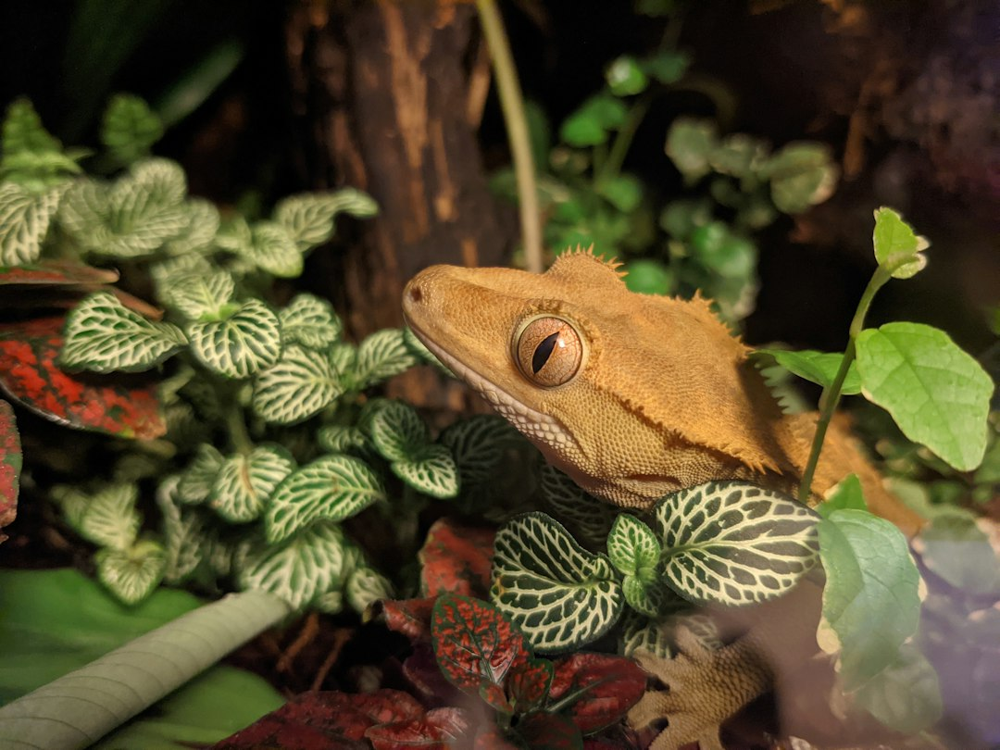

Most substrate arguments for crested geckos are really arguments about water. Humidity, mold, stale odors, and a soggy enclosure floor all trace back to how a material absorbs moisture, how long it holds it, and where the excess goes. Sphagnum moss and coco fiber sit at opposite ends of that spectrum, and picking the wrong one for your setup is one of the most common reasons a "simple" crested gecko enclosure turns into a maintenance chore.

A practical starting point for healthy adult geckos is that coco fiber should be the main floor for most keepers, and sphagnum moss should be a targeted humidity tool rather than a full substrate. Coco fiber drains more predictably, dries on a schedule you can manage, and is easy to spot clean. Sphagnum holds far more water than coco and stays wet longer, which makes it excellent in a small humid hide or a laying area and risky as a deep, enclosure-wide layer.

This guide compares the two on moisture retention, drainage, safety, upkeep, and cost, then walks through a layered build that uses each where it performs best.

Photo by <a href="https://unsplash.com/@georgemillson?utm_source=artlines_blog&utm_medium=referral">George Millson</a> on <a href="https://unsplash.com/?utm_source=artlines_blog&utm_medium=referral">Unsplash</a>

## Sphagnum Moss Versus Coco Fiber: How Each Handles Moisture

Crested geckos do best with a daily humidity cycle: a spike to roughly 70 to 80 percent after an evening misting, then a drop toward 50 percent or so during the day. That drying phase matters. A substrate that never dries out keeps the whole enclosure at a constant damp level, which favors mold, bacteria, and skin or respiratory trouble. [ReptiFiles’ crested gecko humidity guidance](https://reptifiles.com/crested-gecko-care/crested-gecko-temperatures-humidity/) describes a humid phase followed by drying before misting again. For the wider context, see our [crested gecko humidity and temperature management guide](/2026/06/15/crested-gecko-humidity-and-temperature-management-guide/).

### Coco fiber: moderate holding, steady release

Coco fiber, often sold as compressed bricks or loose bags, is made from processed coconut husk. It absorbs water readily, holds a useful amount, and releases it into the air gradually. When you mist, the top layer darkens, the deeper layer stays slightly damp, and the surface lightens again within several hours in a ventilated enclosure.

That behavior is what you want from a floor. It adds a little ambient humidity without becoming a reservoir that you have to manage. The tradeoff is that coco fiber is a fine, loose material. It clumps when oversaturated and packs down over time, which reduces airflow through the bottom layers.

### Sphagnum moss: a sponge with a long memory

Long-fiber sphagnum moss behaves differently from fine coconut fiber. Dried sphagnum is commonly described as holding many times its own weight in water, and it releases that moisture slowly. Soak it, squeeze it out, and a handful will keep a humid microclimate going for a long time.

That is a feature in a small container and a liability across an entire floor. A deep sphagnum bed stays wet for days, especially in a glass enclosure with limited ventilation. The surface may look fine while the base turns anaerobic, which is where sour smells come from.

### The practical difference

Think of coco fiber as a regulator and sphagnum as a reservoir. A regulator suits a floor that you mist daily. A reservoir suits a spot the gecko visits only when it wants extra humidity, such as a hide, a shed box, or a lay box. Using each for its natural role solves most moisture problems before they start.

## Drainage: What Happens Below the Surface

Moisture on the surface is easy to judge by eye. Moisture at the bottom is where problems hide, and drainage is the main reason keepers who do the same misting routine get very different results.

### Why drainage matters for crested geckos

Every misting adds water that has to leave the system by evaporation, absorption, or drainage. In a standard glass terrarium with a solid floor, drainage is nonexistent. Water that passes through the substrate pools at the bottom. If the substrate is thick and absorbent, that pool is invisible until you smell it or dig down.

### Coco fiber drainage

Fine coconut fiber can compact, and its drainage varies with particle size, packing, depth, and water input. Do not assume a particular depth makes it drain safely. For a planted build, choose a documented terrarium mix rather than adding loose bark or wood chips that the gecko could swallow. Many keepers also add a drainage layer of clay pebbles or similar material beneath a mesh or landscape fabric divider to give excess water a place to go that is not the substrate itself.

### Sphagnum moss drainage

Sphagnum does not really "drain" in the way a granular substrate does. It holds water within its fibers, and what it releases it releases slowly by evaporation. Put it over a drainage layer and it will still stay wet, because the moisture is trapped inside the moss rather than flowing through it. That is why a thick sphagnum floor takes so long to dry and why it should be treated as a high-moisture accent.

### Drainage layers and false bottoms

A false bottom is a barrier that keeps substrate out of a lower water reservoir. Done well, it prevents pooled water from soaking the substrate and gives bioactive setups a drainage zone. Done poorly, it becomes a stagnant swamp under a pretty surface. If you use one, keep the reservoir shallow, make sure the barrier is sturdy, and plan an easy way to check and empty the zone. Our guide to [bioactive lighting setups](/2026/06/29/best-reptile-lighting-setups-bioactive-enclosures/) covers the plant side of these builds in more detail.

## Crested Gecko Substrate Safety: Impaction, Mold, and Ingestion

Moisture performance is only half the decision. A substrate also has to be safe if the gecko licks it, brushes against it, or accidentally swallows some while hunting.

### Impaction risk

Crested geckos eat a paste diet, so accidental ingestion happens mostly when a gecko strikes at a feeder insect or licks a wet surface. Loose particulate substrates carry a small but real impaction risk for very young or underweight animals. [ReptiFiles’ substrate guidance](https://reptifiles.com/crested-gecko-care/crested-gecko-substrate/) warns of loose-particle ingestion risk in small geckos and lists paper towels as an alternative. Age alone is not a reliable readiness test: consider body size, feeding, health and veterinary advice. If you want a full rundown of options, our post on the [best substrates for crested geckos](/2026/06/19/best-substrates-crested-gecko/) covers the whole field.

Sphagnum has a different issue: long fibers can wrap around insects and be swallowed with them. For that reason, sphagnum is best kept in a contained area and not used as a feeding-zone floor.

### Mold and contamination

Both materials can grow mold when kept constantly wet. Sphagnum has a reputation for being somewhat resistant to bacterial growth, which is one reason it is used in horticulture for propagation. That resistance should not be mistaken for immunity. A deeply saturated sphagnum pad in a stagnant corner will still go bad. Coco fiber tends to show mold as white fuzzy patches or fungal "fruiting" growth, which is often harmless on its own but a sign that the enclosure is too wet or under-ventilated.

### Cleanliness and fertilizer contamination

Buy substrates labeled for reptile or terrarium use. Check the ingredient list and preparation instructions; a reptile label alone does not establish safety for every animal. Avoid garden sphagnum or soil that contains added fertilizers, wetting agents, or pesticides. The same goes for any pine or cedar product, which should not be used with reptiles because of the aromatic compounds involved. When in doubt, check the manufacturer's product page and the guidance from a reptile-focused veterinary source such as the [Association of Reptile and Amphibian Veterinarians](https://arav.org).

### Health signals to watch

Persistently damp substrate can contribute to skin problems, shedding trouble, and respiratory stress. If you see stuck shed on toes or tail tip, bubbling at the nose, open-mouth breathing, or lethargy, treat it as a medical question rather than a substrate tweak. Our posts on [crested gecko molting problems](/2026/09/28/crested-gecko-molting-problems-troubleshooting-and-solutions/) and [respiratory infections and eye health](/2026/10/09/crested-gecko-respiratory-infections-and-eye-health-prevention/) explain the warning signs, and a reptile-savvy vet should handle anything beyond a minor husbandry correction.

## Sphagnum Moss Versus Coco Fiber Side by Side

Here is how the two materials compare across the factors that matter in daily keeping.

| Factor | Coco fiber | Sphagnum moss |
|---|---|---|
| Water absorption | Good, moderate capacity | Very high capacity |
| Moisture release | Gradual, dries in hours to a day | Very slow, stays wet for days |
| Drainage behavior | Drains reasonably if not compacted | Holds water in fibers, minimal drainage |
| Best role | Main floor substrate | Humid hide, lay box, or accent patch |
| Mold risk | Moderate if kept saturated | Moderate to high if packed deep and wet |
| Ingestion concern | Fine particles, mostly a juvenile concern | Long fibers can tangle around feeders |
| Spot cleaning | Easy, remove clumps and waste | Harder, waste soaks into the mat |
| Replacement frequency | Partial refresh monthly, full change every few months | Replace small patches every few weeks |
| Cost per use | Low, expands from a brick | Higher per cubic inch of coverage |

### Reading the table

The pattern is clear. Coco fiber wins at every task that involves being a floor: it drains better, cleans up easier, and costs less per square foot of coverage. Sphagnum wins at one task: creating a stable pocket of high humidity in a small footprint.

If you only buy one, buy coco fiber. If you want a more forgiving humidity gradient without raising the whole enclosure's moisture, add a small container of sphagnum. That combination covers nearly every need a crested gecko has for a moist microclimate.

### When a separate laying area needs different management

A laying box for an adult breeding female has a different purpose from an enclosure floor. Follow a species-specific breeding plan or veterinary advice for that container. Do not extend egg-incubation or laying-box advice to hatchlings or sick geckos. For an animal needing close monitoring, plain paper towels make it easier to inspect droppings and remove contaminated material. If you plan to breed, our guide to [breeding crested geckos from courtship through hatchling care](/2026/10/19/breeding-crested-geckos-complete-guide-from-courtship-through-hatchling-care/) covers lay box preparation in more detail.

### When coco fiber alone is enough

For most adult pets in a front-opening or screen-ventilated enclosure with a daily misting, a coco fiber floor with a few hides and plenty of foliage is enough. You do not need sphagnum to keep a gecko healthy. You need a humidity cycle, a place to drink, and a floor that dries between mistings.

## Build a Layered Crested Gecko Substrate Setup

A layered build uses each material where it performs best. These steps assume an appropriately sized adult enclosure with adequate ventilation. Substrate work does not compensate for an undersized enclosure or inadequate climbing space.

1. **Choose a ventilated enclosure.** Cross-ventilation (side or front vents plus a screen top) lets moisture escape and prevents the stagnant air that turns damp substrate sour.
2. **Add a drainage layer if you want one.** Spread about an inch of clay pebbles or similar material across the base and cover it with mesh or landscape fabric so the substrate above stays separate. Skip this layer if you prefer a simple build and plan to monitor moisture by hand.
3. **Prepare the coco fiber.** Expand a brick in clean water, then squeeze it until it is damp but not dripping. It should hold together when pressed and not release water when squeezed.
4. **Lay two to three inches of coco fiber.** Avoid tightly compressing the layer. If you need a more structured planted mix, follow a documented reptile-care recipe and check ingestion risks rather than adding exposed wood chips at random.
5. **Build the humid zone.** Place a small container, such as a deli cup with an entry hole, filled with damp (not soaked) sphagnum in a shaded corner. This gives your gecko a high-humidity retreat without raising the floor's moisture.
6. **Add cover and climbing space.** Cork flats, branches, and foliage give your gecko places to hide and climb, and plants help moderate humidity through transpiration.
7. **Mist in the evening and let it dry.** Mist lightly and consistently, and watch how fast the surface dries before the next misting. Adjust frequency and volume rather than adding more sphagnum.

### Lighting and plants affect moisture

If you add live plants, light matters. A planted setup gives you natural humidity buffering and more cover, but plants need adequate light to survive, and a struggling plant will rot in damp substrate. Use plant lighting suited to the enclosure and keep fixtures and electrical connections protected from mist. Check the manufacturer's specifications for coverage area and mounting requirements so the fixture fits your enclosure size. Crested geckos can benefit from appropriately specified UVB; lighting and supplementation need a species-specific plan. See our discussion of [UVB lighting for crested geckos](/2026/10/23/best-uvb-lighting-for-crested-geckos-nocturnal-needs-and-top-fixtures/).

### Automatic misting and moisture control

If you automate misting, your substrate choice matters even more, because a timer will keep adding water whether the floor needs it or not. Our comparison of [automatic misting systems for crested gecko humidity control](/2026/09/25/best-automatic-misting-systems-for-crested-gecko-humidity-control/) explains how to set cycles so they work with your substrate instead of against it.

## Common Substrate Mistakes and Troubleshooting

Most substrate problems come from a short list of repeatable errors. Here are the ones to avoid, along with the fix for each.

**Using sphagnum as a deep floor.** A thick sphagnum bed stays wet far longer than the gecko needs and is hard to spot clean. The fix is to keep it to a small container or a thin patch, and replace it every couple of weeks.

**Oversaturating coco fiber.** If water pools or the substrate squishes underfoot, you are adding more than the enclosure can shed. Reduce misting volume, mix in coarser material, and open ventilation. A fan on low or a wider vent can help, but check that it does not dry the enclosure so much that humidity never spikes.

**Compacted lower layers.** Coco fiber that is packed tightly stops draining. If the bottom half smells sour or looks dark and slimy, replace it rather than trying to dry it out in place. Fluff the new layer and add chips or bark.

**Skipping ventilation.** A damp substrate in a sealed tank breeds mold. If you see persistent fuzzy growth, improve airflow before you change anything else. Springtails can help control surface mold in a bioactive setup, but they are a supplement to good ventilation, not a replacement.

**Ignoring the smell.** A healthy enclosure smells earthy or neutral. A sour, swampy, or ammonia-like odor means moisture and waste are building up. Spot clean, replace the affected area, and check drainage.

**Using young animals on loose substrate too early.** Hatchlings and small juveniles are the most vulnerable to ingestion problems. Paper towels are boring but safe until the gecko is larger, eating well, and tracking prey accurately.

**Troubleshooting checklist:** if the enclosure stays wet all day, cut misting volume first, then improve ventilation, then reduce substrate depth. If humidity never rises, check that you are misting enough surface area, then consider a thin patch of damp sphagnum in a hide. If your gecko seems unwell, call a reptile vet. Our guide to [finding a herp vet on a budget](/2026/07/27/reptile-veterinary-care-finding-a-herp-vet-on-a-budget/) can help if cost is a concern.

## Frequently Asked Questions

### Can I use sphagnum moss as the only substrate for a crested gecko?

You can, but it is not the best choice for most keepers. Sphagnum holds so much water that a full floor stays wet for days, which raises the risk of mold, bacterial growth, and stagnant odors, especially in poorly ventilated enclosures. It is also harder to spot clean because waste soaks into the mat, and long fibers can wrap around feeder insects and be swallowed. A better approach is coco fiber for the main floor with sphagnum in a contained humid hide. If you do try sphagnum alone, use a thin layer, ensure strong ventilation, and replace it frequently.

### Is coco fiber safe for baby crested geckos?

Coco fiber is widely used, but hatchlings and small juveniles are the group most at risk from accidental ingestion of loose particles. Many keepers start babies on paper towels for the first few months, then move to coco fiber once the gecko is larger, eating consistently, and handling live prey without much difficulty. Do not treat dampening loose substrate as a way to make it safe for a small gecko. Use paper towels while monitoring growth, feed from an elevated cup, and seek species-specific veterinary advice before changing a vulnerable animal to loose substrate. If your gecko stops eating or looks bloated, contact a reptile veterinarian.

### How often should I replace coco fiber and sphagnum moss?

Coco fiber can usually be spot cleaned daily and partially refreshed monthly, with a full replacement every few months depending on enclosure size, humidity, and bioactive setup. Sphagnum in a humid hide should be replaced more often, typically every two to four weeks, because it stays wet and can sour. Replace either material sooner if you see persistent mold, smell sour or ammonia-like odors, or notice that the layer has compacted and no longer dries between mistings. A bioactive setup with a cleanup crew will have different timing and may last longer between full changes.

### What is the best way to improve drainage in a crested gecko enclosure?

Start with ventilation, because airflow does more to dry a substrate than any layer below it. Then loosen the substrate by mixing coco fiber only as recommended by a documented reptile-care recipe, avoiding exposed wood chips that could be swallowed. If you want a drainage layer, use clay pebbles or similar material under a sturdy mesh or landscape fabric barrier and keep the reservoir shallow so you can check it. Finally, reduce misting volume if water pools. A well-ventilated, lightly misted enclosure usually drains and dries better than a heavily misted one with a complicated false bottom.

## Conclusion
For most crested gecko keepers, the decision is simple: use coco fiber as the main floor and sphagnum moss as a small, replaceable humid retreat. That split gives you predictable drying, easier cleaning, and a backup source of humidity when your gecko needs it, without turning the whole enclosure into a wet sponge.

Your next step is to look at your current setup. Press a finger into the substrate: if it feels soggy or smells sour, loosen it, improve ventilation, and cut back on misting volume. If it is bone dry by midday and humidity never rises, add a damp sphagnum container to one hide and watch how your gecko uses it. Small, deliberate adjustments beat big rebuilds.

If this comparison helped, bookmark it for your next enclosure refresh and leave a comment with the substrate setup you are using.

**Related reading**
- [Best Substrates for Crested Geckos](/2026/06/19/best-substrates-crested-gecko/)
- [Crested Gecko Humidity and Temperature Management Guide](/2026/06/15/crested-gecko-humidity-and-temperature-management-guide/)

  
<strong>About the Author</strong>

  
The Scaled Keeper team researches reptile husbandry with a focus on gecko and lizard care. Our guides synthesize keeper community data, veterinary sources, and documented husbandry outcomes - so you can make informed decisions for your animals.

